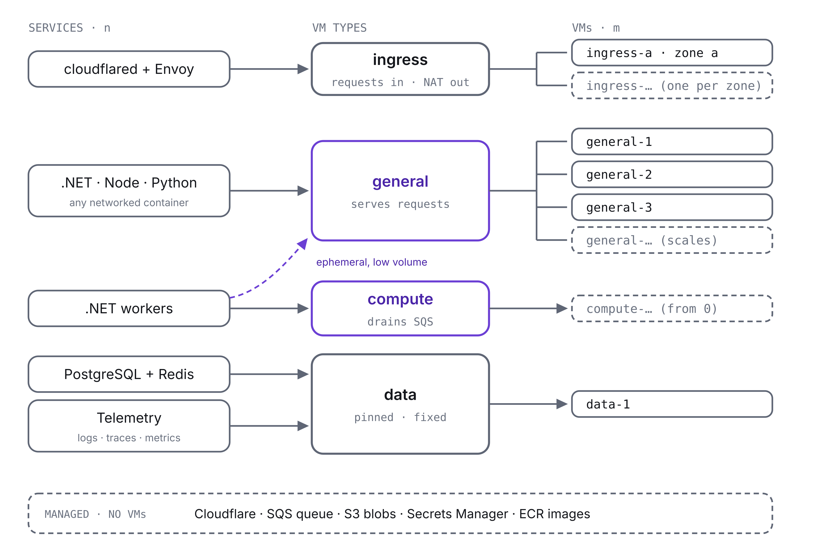
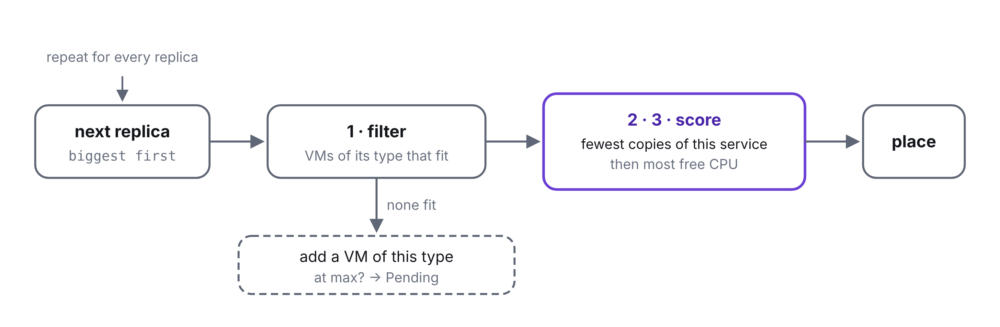

# ProtoStrap

## What is it?

ProtoStrap is an infrastructure platform for web applications that start small and need
room to grow.

- **It is a scheduler.** It scales a pool of self-managed VMs and decides how many
  replicas of each service run and on which VM, down to zero when a service needs none.
- **It is a ready-made stack.** Traffic enters through Cloudflare and a cloudflared
  tunnel, so the VMs expose no inbound ports. An API gateway routes requests to .NET,
  Node and Python services, which use a SQL database, a key-value store, a blob store and
  a job queue. Telemetry keeps their logs, traces and metrics, to read in Grafana.
- **It is a path to managed services.** Many components start out self-hosted on the
  VMs. Each one can move to its managed AWS counterpart on its own, once its scale makes
  the extra cost worthwhile (see [Path to managed services](#path-to-managed-services)).

ProtoStrap knows nothing about the application it runs: everything comes from the
application's `protostrap.yaml`.

| To                                              | See                                                 |
| ----------------------------------------------- | --------------------------------------------------- |
| Try it end to end, with the sample application  | [sample/README.md](sample/README.md)                |
| Set up an AWS account for an application        | [infra/README.md](infra/README.md)                  |
| Take an application to production               | [Going to production](docs/production.md)           |
| Write a `protostrap.yaml`                       | [Spec](docs/protostrap.md#spec)                     |
| See what runs where, and why                    | [Operator UI](docs/protostrap.md#operator-ui)       |
| Read the services' logs, traces and metrics     | [Telemetry](docs/telemetry.md)                      |
| Generate it from a .NET Aspire AppHost          | [hosting/README.md](hosting/README.md)              |
| Set or rotate a secret                          | [Secrets](docs/secrets.md)                          |
| Send mail from the application                  | [Email](docs/email.md)                              |
| Give a component config files, or configure it through its API | [Config files](docs/config.md)       |
| Give a coding agent ProtoStrap's rules          | [ProtoStrap's skills](plugins/protostrap/README.md) |
| See how it is built                             | [How ProtoStrap is built](docs/protostrap.md)       |

| Path                                       | What it is                                                                                                                    |
| ------------------------------------------ | ----------------------------------------------------------------------------------------------------------------------------- |
| [`cmd/protostrap`](cmd/protostrap)         | The one program: the agent, the scheduler, the reporter, the edge, telemetry, and the workflows' `check`, `plan`, `release` and `deploy` |
| [`internal`](internal)                     | Its packages, Go standard library only                                                                                        |
| [`edge`](edge)                             | The edge's image: cloudflared, Envoy and `protostrap edge`                                                                    |
| [`telemetry`](telemetry)                   | The telemetry image: the OpenTelemetry collector, Loki, Tempo, Prometheus, Grafana and `protostrap telemetry`                 |
| [`infra`](infra)                           | Terraform: `bootstrap`, `platform` and `people`                                                                               |
| [`.github`](.github)                       | The reusable `plan`, `infra` and `deploy` workflows, and the sample's                                                         |
| [`scripts`](scripts)                       | For Org Admins, setting the edge's tunnel token and other secrets; for Platform Admins and Org Admins, opening the operator UI; for Developers too, opening Grafana |
| [`hosting`](hosting)                       | ProtoStrap.Hosting: describe an application's components in an Aspire AppHost, which writes its `protostrap.yaml`             |
| [`sample`](sample)                         | The sample application: one component of every kind, for testing deploys and scaling                                          |
| [`plugins/protostrap`](plugins/protostrap) | Skills for agents working in an application's repository, installed at ProtoStrap's version                                   |
| [`docs`](docs)                             | The design                                                                                                                    |


## Components

Components are either self-managed, running as containers on ProtoStrap's VMs, or managed
by Cloudflare or AWS.

### Self-managed

Each self-managed component declares:

- **VM type:** the pool of VMs it runs on (see [VMs](#vms)).
- **Request:** the CPU and memory one replica reserves. Placement and VM sizing count
  requests, not live usage.
- **Dependencies:** the other components it needs to reach.
- **Scaling:** its demand signals, limits, and minimum and maximum replicas (see
  [Scaling replicas](#scaling-replicas)).

| Component       | Technology                                                           | VM type | Provides                                                                |
| --------------- | -------------------------------------------------------------------- | ------- | ----------------------------------------------------------------------- |
| **CDN tunnel**  | cloudflared                                                          | Ingress | Outbound tunnel to Cloudflare, so VMs expose no inbound ports           |
| **API gateway** | Envoy                                                                | Ingress | Routing, load balancing across service replicas, optional rate limiting |
| **Services**    | .NET gRPC services, Node.js Express servers, Python FastAPI services | General | Handle requests routed by the gateway                                   |
| **Workers**     | .NET workers                                                         | Compute | Process jobs from the queue. Can run on general VMs at low job volume.  |
| **Database**    | PostgreSQL                                                           | Data    | SQL database                                                            |
| **KV store**    | Redis                                                                | Data    | Key-value store                                                         |
| **Telemetry**   | OpenTelemetry collector, Loki, Tempo, Prometheus, Grafana            | Data    | Logs, traces and metrics, and a place to read them ([Telemetry](docs/telemetry.md)) |

### Managed

| Component              | Service             | Provides                          |
| ---------------------- | ------------------- | --------------------------------- |
| **CDN**                | Cloudflare          | Public entry point, DNS, TLS, WAF |
| **Queue**              | Amazon SQS          | Job queue                         |
| **Blob store**         | Amazon S3           | Object storage                    |
| **Secrets**            | AWS Secrets Manager | One secret per environment, with every component's keys |
| **Email**              | Amazon SES          | Sending mail from the application's domains, if it sends any |
| **Container registry** | Amazon ECR          | Container images                  |


## VMs

Every VM has a type, and the type determines which components run on it. VMs of the same
type form a pool that scales on its own.

| Type        | Runs                                                          | Role                    | Pool size         |
| ----------- | ------------------------------------------------------------- | ----------------------- | ----------------- |
| **Ingress** | cloudflared, API gateway, NAT for the other VMs               | Takes requests in, sends traffic out | Fixed, one VM per zone |
| **General** | Services; workers at low job volume                           | Serves requests         | Scales            |
| **Compute** | Workers                                                       | Drains the job queue    | Scales, from zero |
| **Data**    | PostgreSQL, Redis, telemetry                                  | Stores state on volumes | Fixed, one VM     |

- **Ingress, general and compute VMs are stateless.** Any replica can run on any VM of its
  type, so replicas can be moved between VMs freely.
- **The ingress VM is the only public one.** It runs nothing but cloudflared and Envoy, and
  forwards the other VMs' outbound traffic, since they have no public IPs.
- **The data VM is stateful.** ProtoStrap starts with one data VM running PostgreSQL,
  Redis and telemetry. All three are pinned to it, and each keeps its data on its own EBS
  volume that outlives the VM, except telemetry's logs and traces, which go to S3.
- **Compute starts at zero.** When job volume is low, workers run as ephemeral replicas
  on general VMs that have spare capacity, so no compute VM is started.



How the pools run on AWS, on Auto Scaling groups for ingress, general and compute and plain
EC2 instances for data, from launch to recovery, is in [VMs on AWS](docs/vms.md).

### What runs on every VM

- **Docker, in Swarm mode**, which runs the components' containers and connects them
  across VMs with one overlay network (see [Discovery](#how-components-connect)).
  ProtoStrap uses Swarm only for this network. It never creates Swarm services, so Swarm
  schedules nothing. Each VM joins the swarm when it boots and leaves it before it is
  removed.
- **Amazon ECR credential helper**, which lets Docker pull images from ECR without a
  manual `docker login`.
- **AWS Systems Manager (SSM) Agent**, which lets you open a shell or run commands on the
  VM through AWS, without opening inbound ports.
- **ProtoStrap agent**, which deploys applications. It uses an LLM agent to watch metrics
  and logs and write reports on them.

The swarm manager runs on the data VM, because the data VM is never removed. If it is
down, running containers keep working, but new replicas can't join the overlay network
until it is back. VMs allow Swarm's traffic between each other on the private network only
(TCP 2377, TCP and UDP 7946, UDP 4789), and Docker sends every replica's output to the
[telemetry](docs/telemetry.md) collector on the data VM (TCP 24224).


## How components connect


- **Requests in.** Users reach Cloudflare, which handles DNS, TLS and the WAF, then sends
  each request down the tunnel to cloudflared. cloudflared dials out to Cloudflare, so
  no VM opens an inbound port. Only the ingress VM has a public IP, and the other VMs'
  outbound traffic leaves through it.
- **Routing.** cloudflared forwards every request to the Envoy on its own VM: there is
  one Envoy for every cloudflared. Envoy maps each host and path to a service, and
  balances each request across that service's ready replicas, on any VM. It balances per
  request, not per connection, so gRPC's long-lived HTTP/2 connections still spread
  across replicas.
- **Discovery.** Every container joins the overlay network under its service's name, such
  as `order-service` or `postgres`. From any VM, Docker's DNS resolves that name to the IPs
  of all the service's replicas. Envoy looks up each service's name every 5 seconds, so it
  finds new replicas and drops removed ones without a config change. It only sends
  requests to replicas whose readiness check passes, and a replica that is shutting down
  fails that check first, so it stops getting requests before it stops.
- **State.** Services and workers read and write PostgreSQL and Redis on the data VM.
- **Jobs.** Services put jobs on the SQS queue. Workers take a job, do the work, then
  delete the message. Queued jobs survive the loss of any VM.
- **Files.** Files live in S3: in the files bucket every application gets, or in buckets of
  its own, which can be versioned, locked or expiring. The database keeps a file's key,
  and a job message carries the key, never the file. Large uploads and downloads go
  straight between the user and S3 with a signed URL, instead of through the tunnel and
  the gateway.
- **Startup.** Before starting a replica, ProtoStrap pulls its image from ECR onto the VM
  it was placed on. The replica reads its keys from the environment's secret when it
  starts, so no secret is baked into an image. A changed key reaches only the components
  it belongs to, within minutes (see [Secrets](docs/secrets.md)).
- **Telemetry.** Docker sends every replica's output to the telemetry collector on the data
  VM, and services that use OpenTelemetry send it their logs, traces and metrics over the
  overlay network. Services can send telemetry but can't read it. People read it in
  Grafana, through an SSM port forward (see [Telemetry](docs/telemetry.md)).

The address ranges, subnets, firewall rules, DNS and Cloudflare settings behind these paths
are in [Network](docs/network.md).


## Scaling

ProtoStrap scales in three steps, each driving the next:

1. **[Replicas](#scaling-replicas).** Each component's demand signals and limits set how
   many replicas it runs. This is fast: a replica starts in seconds.
2. **[Placement](#placing-replicas).** Each new replica goes to a VM of its type with room
   for its request. When a component needs fewer, ProtoStrap
   [chooses which to stop](#removing-replicas).
3. **[VMs](#scaling-vms).** Each pool grows to fit the replicas assigned to it, and adds a
   VM when a replica has nowhere to go. This is slow: a VM takes minutes to boot.

Load decides replicas, and replicas decide VMs: a VM is added for replicas that need room,
never because a VM looks busy. The data VM is the exception. It is fixed, and PostgreSQL,
Redis and telemetry only grow when you resize it.

### Scaling replicas

Each self-managed component declares how it scales: the **demand signals** that show it
needs more capacity, any **limits** that cap how much extra capacity can help, and how to
add that capacity:

- **Scale up:** give each replica more CPU and memory, on a bigger VM if needed. This only
  helps apps that use the extra cores, such as multi-threaded apps, and it stops at the
  largest VM. Resizing restarts the replica.
- **Scale out:** add replicas. This helps any stateless app, multi-threaded or not, and it
  also adds resilience: a crash or a lost VM takes down one replica, not the whole service.
  For single-threaded apps, which use one core per process, it is the only way to grow.
  Once a VM's capacity is in use, more replicas need another VM.

#### Demand signals and limits

**Demand signals** measure load arriving or work waiting: CPU, requests per replica, queue
depth. They say how many replicas would help.

**Limits** cap how many replicas can help, for reasons that have nothing to do with VMs: a
rate limit on a third-party API shared by every replica, a cap on database connections, a
spending budget. Past a limit, more replicas add errors and retries, not throughput.

ProtoStrap combines the two without knowing what sits behind a limit. It only reads metrics:

```
desired replicas = clamp(min(demand, limit cap), min replicas, max replicas)
```

Demand comes from the component's signal. The two main forms:

```
# Services, from CPU: keep each replica near its target usage
demand = ceil(replicas × average usage / target)

# Workers, from the queue: clear all unfinished work within the drain time
work   = waiting + in flight    # across every replica, including ephemeral ones on general VMs
demand = ceil(work / (jobs per second per replica × drain seconds))
```

To keep the count steady:

- Count only ready replicas. One that is still starting reports little CPU and drags the
  average down.
- Scale up on a short average (about a minute). Scale down only on the highest demand seen
  over the last few minutes.
- Ignore small swings: no change while average usage is within about 10% of the target.

Worked examples, from CPU, from a queue, with a rate limit and with a monthly budget, are
in [Scaling examples](docs/scaling-examples.md).

#### By component

| Component              | Threading                  | Watch                                                                            | Scale                                                                                       |
| ---------------------- | -------------------------- | -------------------------------------------------------------------------------- | ------------------------------------------------------------------------------------------- |
| **cloudflared**        | Multi-threaded             | CPU, concurrent requests                                                         | Fixed at 1 replica, since Cloudflare doesn't spread requests across replicas. Up if busy.   |
| **Envoy**              | One worker thread per core | CPU, active connections, latency the gateway adds                                | Up only. One Envoy runs beside each cloudflared.                                            |
| **.NET gRPC services** | Multi-threaded             | CPU, memory, request latency, thread pool queue length                           | Up first, since a bigger VM may be enough. Out when one VM no longer is.                    |
| **Node.js Express**    | Single-threaded            | Event loop lag, CPU per process, request latency                                 | Out. When the VM's cores are all in use, add a VM.                                          |
| **Python FastAPI**     | Single-threaded (GIL)      | Event loop lag, CPU per process, request latency                                 | Out, by adding worker processes or replicas                                                 |
| **.NET workers**       | Multi-threaded             | SQS queue depth, age of the oldest message, any declared limits                  | Out, from zero: on general VMs at low job volume, then on compute VMs                       |
| **PostgreSQL**         | Multi-process              | CPU, memory and cache hit rate, disk latency and IOPS, connections, storage used | Up, with a bigger VM or a faster volume. Then move to Amazon RDS.                           |
| **Redis**              | Single-threaded commands   | Memory used against its limit, evictions, main-thread CPU, latency               | Up for memory. When its one thread is saturated, shard it or move it to Amazon ElastiCache. |
| **Telemetry**          | Multi-process              | Memory against its request, the collector refusing data, volume space used       | Fixed at 1 replica. Up, with a bigger `request`, as long as it still fits on the data VM.   |

For Node and Python, watch CPU per process, not VM-wide CPU: one busy process maxes out a
single core while the VM looks mostly idle.

### Placing replicas

For each replica that needs a VM, ProtoStrap looks only at VMs of the replica's type and:

1. **Filters** to VMs with enough free CPU and memory for its request.
2. **Prefers** the VM with the fewest replicas of the same service, so a service's
   replicas spread across VMs.
3. **Breaks ties** by the most free CPU, so load stays even and no VM becomes a hot spot.

If no VM has room, the pool needs another VM: one is added if the pool is below its
maximum, otherwise the replica waits as pending. Replicas with the biggest requests are
placed first, so they find room before small ones fragment the space.

cloudflared and its Envoy are placed as one unit, on the ingress VM, where nothing else
runs. PostgreSQL, Redis and telemetry are not placed by this rule: all three stay pinned
to the data VM.



### Removing replicas

When a component needs fewer replicas, ProtoStrap chooses which ones to stop. It:

1. **Takes** replicas that aren't serving yet first: pending ones, then ones still
   starting.
2. **Prefers** the VM with the most replicas of the same service, so the replicas that
   remain stay spread across VMs.
3. **Breaks ties** by the most free CPU, so the emptiest VM empties first and can be
   removed without moving replicas (see [Scaling VMs](#scaling-vms)).

Workers come off compute VMs before general VMs, the reverse of the order they were added
in, so the compute pool can return to zero.

Only services and workers are removed this way. cloudflared and Envoy run as one fixed
pair, and PostgreSQL, Redis and telemetry stay pinned to the data VM.

A replica stops in steps, so no request or job is lost:

- **Services** fail their readiness check first, so Envoy stops sending them requests.
  ProtoStrap waits for Envoy to notice, gives requests already in progress a time limit to
  finish, then stops the container.
- **Workers** stop taking jobs from the queue and finish the ones in flight. A job still
  running at the time limit goes back to the queue for another replica to pick up.

Moving a replica, for example off a VM that is being removed, starts the new replica first
and stops the old one only once the new one is ready, so the service never runs short.

### Scaling VMs

Each pool scales on its own. Two triggers add VMs, and they do different jobs.

**1. Sizing, the normal case.** Every cycle, ProtoStrap works out how many VMs each pool
should have from the CPU and memory requested by the replicas assigned to it:

```
usable per VM = (VM capacity − reserved for the OS) × target utilisation   # for CPU and for memory
needed        = max(ceil(CPU requested / usable CPU), ceil(memory requested / usable memory))
VMs           = clamp(needed + spare VMs, min VMs, max VMs)
```

Keeping the target below 100% and adding a spare VM leaves room free, so a new replica can
usually be placed at once instead of waiting minutes for a VM to boot.

For example, general VMs with 4 vCPU, 400m reserved and a 70% target have
(4000m − 400m) × 70% = 2,520m usable each. Replicas requesting 8,200m in total need
ceil(8200 / 2520) = 4 VMs, plus 1 spare: 5 VMs.

**2. A replica with nowhere to go, the safety net.** Sometimes a replica can't be placed
even though the totals say it should fit:

- **Fragmentation:** three VMs each have 1,000m free, but the replica needs 2,000m.
- **Pairs:** cloudflared and Envoy must share a VM, and no single VM has room for both.

The replica waits as pending, and the pool adds a VM if it is below its maximum (see
[Placing replicas](#placing-replicas)). If replicas are often pending, sizing has too
little headroom, or replicas are too big for the VM size.

So a pool runs whichever is larger: the VMs that sizing wants, or the VMs that placement
needs.

**Removing VMs** only follows sizing, and slowly. When sizing has wanted fewer VMs for
about 10 minutes, and the replicas on the emptiest VM fit on the others, ProtoStrap stops
placing replicas on that VM, moves its replicas off (placing each with the same rule, and
starting each new replica before stopping the old one), and then removes the VM. It
removes one VM at a time.

**By pool:**

- **Ingress** is fixed at one VM per zone. If the edge outgrows it, the ingress pool moves
  to a bigger type.
- **General** scales as above.
- **Compute** can sit at zero VMs, because it keeps no spare VM. Ephemeral workers running
  on general VMs don't count towards its sizing. Compute starts its first VM only when the
  workers no longer fit in general's spare capacity.
- **Data** is fixed. Sizing only tells you whether the fixed size is still big enough.


## Path to managed services

ProtoStrap starts with most components self-hosted on its VMs, in one availability zone.
Cloudflare, SQS, S3, Secrets Manager and ECR are managed from day one.

**High availability.** ProtoStrap does not spread VMs or replicas across availability
zones, so an outage in a single zone can take the whole application offline, including
PostgreSQL, Redis and telemetry on the data VM. cloudflared and Envoy also run one replica each, so
restarting or moving either, or losing their VM, takes the application offline until it is
back. Components moved to managed AWS services can use those services' own multi-zone
options instead.

The self-hosted components move to managed AWS services one at a time, in roughly this
order, each once its scale or risk makes the extra cost worthwhile.

**1. Database: PostgreSQL to Amazon RDS for PostgreSQL (or Aurora).**

- Move when: the data can't be lost or be offline for long, backups and upgrades take
  real effort, or the database needs a bigger data VM than is sensible.
- What changes: RDS runs a standby in another availability zone and takes backups for
  you. Services read the new connection details from the environment's secret. Migrate with a dump
  and restore in a short maintenance window, or with replication and a quick cutover.

**2. KV store: Redis to Amazon ElastiCache.**

- Move when: Redis holds data you can't rebuild, its memory outgrows its share of the
  data VM, or its single command thread is saturated.
- What changes: ElastiCache runs replicas in other availability zones and fails over on
  its own. Once both PostgreSQL and Redis have moved, only the ingress, general and compute
  pools remain, plus the data VM, kept on at a smaller size as a control VM for the swarm
  manager and telemetry (see
  [Moving PostgreSQL and Redis](docs/vms.md#moving-postgresql-and-redis)).

**3. Spread VMs across availability zones.**

- Move when: an outage in a single zone taking the application offline is no longer
  acceptable.
- What changes: the general and compute pools run VMs in two or three zones, placement
  spreads each service's replicas across them, and an ingress VM runs in each zone. This is
  worth doing only after steps 1 and 2: until then, PostgreSQL and Redis are pinned to one
  zone, and a zone outage still takes them down.

**4. Services and workers: to Amazon ECS on AWS Fargate (optional).**

- Move when: running VM pools costs more effort than Fargate's higher price per CPU.
- What changes: AWS runs each container without VMs to manage. Workers are a natural first
  candidate, because they are bursty and often at zero. cloudflared and Envoy run together
  as one ECS task, so they stay paired, a NAT gateway takes over the ingress VM's NAT, and
  ECS's own service discovery replaces the overlay network. Once everything has moved,
  ProtoStrap no longer manages VM pools, and the scaling rules in this document become ECS
  scaling settings.
