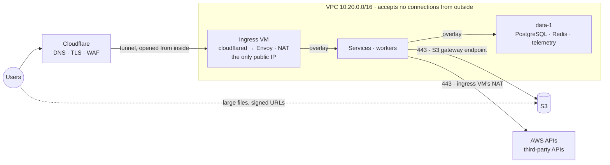

# Network

How requests reach ProtoStrap, how its VMs and containers talk to each other, and how
traffic leaves. Which components talk to which is in the README's
[How components connect](../README.md#how-components-connect), and the VMs themselves are
in [VMs on AWS](vms.md). This document describes the design. The infra code and the agent
hold the exact configuration.

Four rules hold throughout:

- **Nothing accepts connections from the internet.** Requests arrive only through a tunnel
  that cloudflared dials out, when the spec has one. Only the ingress VMs have public IPs,
  and they accept nothing from outside.
- **Services talk on the overlay, VMs on the VPC.** No service can reach a port on a VM.
- **One way out.** The other VMs have no public IPs. They reach the internet through the
  ingress VM's NAT, and S3 through the free gateway endpoint.
- **No address range overlaps another,** so connecting another network or moving to
  managed services never means renumbering.

## At a glance

A request reaches Cloudflare, comes down the tunnel to the ingress VM, and crosses the
overlay to a service. Services reach PostgreSQL and Redis over the same overlay, S3 through
the gateway endpoint, and everything else through the ingress VM's NAT. The tunnel doesn't
use the NAT: cloudflared goes out from the ingress VM's own IP. Arrows show the way requests
travel, not who opened the connection: the tunnel carries requests into the VPC, but
cloudflared opened it from inside, so no port is open.

Every flow, and the path it takes:

| Traffic             | From → to                                                 | Path                                                     |
| ------------------- | --------------------------------------------------------- | -------------------------------------------------------- |
| Requests            | Users → Cloudflare → cloudflared                          | The tunnel, which cloudflared opens from the ingress VM     |
| Operator UIs        | Operators → Cloudflare Access → cloudflared               | The tunnel, once Access has checked who they are         |
| Routing             | cloudflared → Envoy                                       | Inside the edge's container                              |
| Service calls       | Envoy and services → services                             | The overlay                                              |
| State               | Services and workers → PostgreSQL and Redis               | The overlay                                              |
| AWS and other APIs  | Services, agents, the scheduler → AWS and third parties   | The ingress VM's NAT                                        |
| S3                  | VMs and services → S3                                     | The S3 gateway endpoint                                  |
| Large files         | Users ↔ S3                                                | The internet, with a signed URL. Never through the VPC   |
| Control             | Agents → the scheduler                                    | The VPC, to data-1's fixed address, over TLS             |
| Telemetry           | Services → the collector on data-1                        | The overlay, to `telemetry`                              |
| Replicas' output    | Docker on every VM → the collector on data-1              | The VPC, to data-1's fixed address, port 24224           |
| Replicas' output, without telemetry | Docker on every VM → CloudWatch Logs      | The ingress VM's NAT                                     |
| AWS credentials     | Services → the agent on their VM                          | Inside the VM                                            |
| Swarm               | Every VM ↔ the swarm manager and each other               | The VPC                                                  |
| Shell access        | Operators → VMs                                           | SSM Session Manager, which each VM dials out to          |
| ProtoStrap's UI     | Operators → data-1's loopback                             | An SSM port forward (see [Operator UI](protostrap.md#operator-ui)) |
| Grafana             | Developers and operators → data-1's loopback              | An SSM port forward of its own (see [Reading telemetry](telemetry.md#reading-telemetry)) |

## Addresses

### The VPC

ProtoStrap runs in one VPC, `10.20.0.0/16`, IPv4 only.

### Subnets

There are four kinds of subnet. Each has a range reserved in every zone, so adding a zone
moves nothing.

| Subnet    | Kind    | Holds                                                        | Range                                  |
| --------- | ------- | ------------------------------------------------------------ | -------------------------------------- |
| `public`  | Public  | Ingress VMs                                                     | `10.20.0.0/24`, a /26 per zone         |
| `nodes`   | Private | General and compute VMs                                      | A /20 per zone, from `10.20.16.0/20`   |
| `data`    | Private | data-1, which runs PostgreSQL and Redis, at a fixed IP       | `10.20.1.0/24`, a /26 per zone         |
| `managed` | Private | RDS, ElastiCache and interface endpoints, once they are used | `10.20.2.0/24`, a /26 per zone         |

Only `public` routes to the internet gateway. `nodes` and `data` send internet traffic to
their zone's ingress VM, and `managed` has no route out (see
[Only ingress VMs are public](#only-ingress-vms-are-public)).

- **`public` holds only ingress VMs,** so nothing else can be given a public IP.
- **`nodes` is large** to leave room for Fargate, which gives every task its own address.
- **`data` is separate** so no other VM can take a data VM's fixed IP while it is replaced.
- **`managed` is separate** so the container firewall can allow it as a whole (see
  [Containers and their VM](#containers-and-their-vm)), and has no route out because
  nothing in it needs the internet.

### Fixed addresses

| Address                     | What                                                                                     |
| --------------------------- | ---------------------------------------------------------------------------------------- |
| `10.20.1.10`                | data-1: PostgreSQL, Redis, the swarm manager and the scheduler. It becomes `control` once PostgreSQL and Redis move to AWS |
| `10.20.1.11`, `10.20.1.12`  | Reserved for data-2 and data-3, in case PostgreSQL or Redis [moves to a VM of its own](vms.md#moving-postgresql-and-redis) |

The agents and the swarm find data-1 by its fixed address, and services find each other by
name, so there is no private DNS zone.

Each zone's ingress VM holds that zone's Elastic IP, the platform's only lasting public IP.
All outbound traffic comes from it, and it never changes, so a third party can allowlist it.

### Docker's ranges

Docker gives containers addresses from its own ranges, which exist only inside each VM.
They must not overlap anything a container needs to reach, such as the VPC, and Docker's
defaults would. So ProtoStrap sets every range itself:

| Range                            | Used for                                                              |
| -------------------------------- | --------------------------------------------------------------------- |
| `10.200.0.0/22`                  | The overlay network: one address per copy of a service                |
| `10.201.0.0/16`                  | Any other swarm network                                               |
| `172.18.0.0/24`                  | The bridge that carries containers' traffic off their VM              |
| `172.17.0.0/24`, `172.19.0.0/16` | Docker's other local bridges                                          |

**The overlay is a /22,** because with every pool at its maximum, ProtoStrap can run more
copies of services than the 250 or so a /24 holds. Docker recommends a /24, but only
because of how Swarm services balance load, and ProtoStrap uses no Swarm services. The
range can only change by creating the network again, which restarts every service, so
load-test it at full size before production.

## Only ingress VMs are public

Only the ingress VMs have public IPs, one per zone. The other VMs have none, and their
subnets have no route from the internet, so nothing outside the VPC can address them at all.
An ingress VM boots with a temporary public IP of its own, so it can reach AWS, and gives it
up when it takes over its zone's Elastic IP.

An ingress VM is a swarm member that can be reached from the internet unless something stops
it. Three things do, so a mistake in one doesn't open a port:

1. **Security groups admit nothing from outside the VPC** (see
   [Security groups](#security-groups)).
2. **The network ACL on the `public` subnet refuses the overlay's, Swarm's, the
   scheduler's and telemetry's ports, and every port below 1024,** from the internet,
   whatever the security groups say. The overlay matters most: its traffic carries no authentication, so if it
   were reachable, anyone could send packets straight to services. Higher ports stay open
   to the ACL, since replies to outbound connections arrive on them.
3. **The infra workflow refuses changes that would open a port,** and AWS Config flags any
   made by hand.

## Requests in

Requests come in through the [tunnel](protostrap.md#tunnel) and the
[gateway](protostrap.md#gateway), each of which runs only when the spec has it. The tunnel
needs the gateway. Without a tunnel, nothing reaches the gateway from the internet:
Terraform makes no tunnel, DNS records or rate limit, and the ingress VMs don't open the
tunnel's port out. Without a gateway, no edge runs, and the ingress VMs only forward their
zone's outbound traffic.

### Cloudflare

The application's domain is on Cloudflare, managed by the infra workflow. Cloudflare:

- **Sends every host to the tunnel.**
- **Terminates TLS,** and sends plain HTTP to HTTPS.
- **Filters traffic** with a broad rate limit per client. Envoy applies its own limits per
  route. No WAF rules are set.
- **Checks who operators are** before they reach an operator UI (see
  [Operator UIs](#operator-uis)).
- **Authenticates the application's mail,** if it sends any: each email domain's DKIM
  records, and the MX and SPF records of its MAIL FROM domain (see [Email](email.md)).
- **Caches static assets,** but not API paths. Every byte it doesn't serve from cache is
  paid for as data out of AWS (see [Costs](#costs)).

### The tunnel

- **There is one tunnel,** created by the infra workflow when the spec has `tunnel`. Its
  routes live in Cloudflare, not on a VM: every host in the gateway's `hosts` goes to Envoy,
  and any other host gets a 404.
- **cloudflared connects to two Cloudflare data centres,** from its ingress VM's own IP, so
  losing one doesn't drop the tunnel. It uses QUIC, and falls back to TCP where UDP is
  blocked.
- **Its token is a secret** that an Org Admin sets, like every secret value (see
  [Identity](identity.md#people)).
- **Its version is pinned** with the edge image, so it never updates itself.

### Operator UIs

Tools for operators, such as the telemetry dashboard, have no sign-in of their own. Each
gets its own hostname, behind Cloudflare Access: a person must sign in and be on an
allow-list of operators' emails before Cloudflare sends any request for that host down the
tunnel.

- **Access can't be bypassed.** The tunnel is the only way in, and Cloudflare applies
  Access before it. So operator UIs need the tunnel: Terraform refuses `operator_hosts` for
  a spec without one.
- **No allow-list, no hostname.** A UI without an Access policy isn't published at all.
- **Hosts with their own sign-in don't use Access,** such as an application's admin pages,
  which check the user's roles themselves.
- **ProtoStrap's own UIs aren't among them.** The operator UI shows the scheduler's state,
  which no container may reach, and Grafana shows every service's logs. Both stay on
  data-1's loopback, and people reach each through an SSM port forward of its own instead
  (see [Operator UI](protostrap.md#operator-ui) and
  [Reading telemetry](telemetry.md#reading-telemetry)).

### cloudflared and Envoy

cloudflared and Envoy run in one container, [the edge](protostrap.md#gateway), alone on its
zone's ingress VM. They start and stop as one, and requests pass from one to the other
without leaving the container. Without a tunnel, the edge runs Envoy alone. Envoy accepts
requests only from cloudflared, so it can trust the client address Cloudflare passes
along. The agent attaches the edge to the overlay so Envoy can reach services.

### What the request path can't carry

- **Native gRPC from outside.** The tunnel doesn't carry it, so external clients, browsers
  included, call services with gRPC-Web, which Envoy translates for services with
  `protocol: grpc` and passes as it is to any other, or with HTTP and JSON that
  the service serves itself. Envoy doesn't turn JSON into gRPC. gRPC-Web carries unary and
  server-streaming calls only. Inside the platform, services call each other with native
  gRPC.
- **Request bodies over 100 MB,** on Cloudflare's Free and Pro plans. Larger uploads go
  straight to S3 with a signed URL.
- **Responses that take more than 120 seconds.** Cloudflare gives up on a response that
  hasn't started within 125 seconds, so Envoy's routes allow 120 seconds for the whole
  response, server streams included, and then cut it. Longer work goes on the job queue,
  and the client checks back for the result.
- **WebSockets.** Envoy's routes don't upgrade connections, so a WebSocket never reaches a
  service.

## Between services

### The overlay network

Services talk on one overlay network, `protostrap`, which spans every VM. The scheduler
creates it with the swarm, on data-1, and the agent attaches each service to it. ProtoStrap
uses Swarm only for this network: it creates no Swarm services, and removes Swarm's own
`ingress` network, so no port can be exposed on every VM by mistake.

### Names

Each service is reachable on the overlay by its name, which Docker answers with the
addresses of all its copies, on every VM. Other names go on to the VPC's resolver.
Docker's answers carry a TTL of several minutes, so anything that looks up names must
ignore the TTL and look again often. Envoy looks every 5 seconds.

### Calling another service

Services call each other by name, straight across the overlay, without going through Envoy.
The caller does the balancing:

- **gRPC clients** balance round-robin over the name and look it up again about every 30
  seconds, so calls spread across copies and reach new ones.
- **HTTP clients** cap a pooled connection's lifetime at about a minute, so new copies get
  traffic.
- **Calls retry when a connection is refused,** which covers a copy that has just stopped.

### Reused addresses

A stopped copy's address can be given to a new copy of another service. Two things keep
requests from following the address to the wrong service:

- **A copy fails its readiness check before it stops,** so Envoy stops using its address
  first (see [how ProtoStrap removes them](../README.md#removing-replicas)).
- **Readiness checks are specific to their service.** A copy answers its check only when
  it is asked for its own service by name.

### Encryption

ProtoStrap doesn't encrypt traffic between VMs, and Docker's own overlay encryption isn't
used: it would run IPsec on every VM and cost CPU. The traffic stays in the VPC, which AWS
keeps private to the account. Graviton3 and later types, such as c7g, m7g and r7g, also
encrypt it in hardware. The burstable t4g and Graviton2 types, such as m6g, don't, so on
them it crosses AWS's network in the clear (see [VM types](vms.md#vm-types)). A component
that needs more encrypts its own connections, as PostgreSQL and Redis can with TLS.

## Between VMs

### Security groups

Every VM, ingress VMs included, has the `node` group. Inbound, it admits only the other VMs,
for Swarm, the overlay, the scheduler, and, with telemetry, replicas' output to it (TCP
24224). Outbound, it allows the same, plus HTTPS to anywhere.

Ingress VMs also have the `ingress` group. It admits HTTPS from the other VMs, for the NAT
to forward, and lets HTTPS out to anywhere, and the tunnel too when the spec has one. Only
ingress VMs can reach Cloudflare's tunnel port.

- **No application port needs a rule.** Service traffic, PostgreSQL and Redis included,
  travels inside the overlay, and so does OTLP to the collector.
- **There is no SSH port.** Operators open shells with SSM Session Manager, which dials
  out.
- **A third-party API on another port** gets its own outbound rule.

### Host to host

- **Agents reach the scheduler** at data-1's fixed address, over TLS (see
  [Agent](protostrap.md#agent)).
- **VMs join the swarm** at the same address, with a token the scheduler hands them.
- **Docker sends replicas' output** to the telemetry collector at the same address, port
  24224, which the telemetry replica publishes on data-1's address alone. Containers can't
  reach it: it is a VM's address (see [Containers and their VM](#containers-and-their-vm)).
  Without telemetry, Docker sends it to CloudWatch Logs instead
  ([Without telemetry](telemetry.md#without-telemetry)).

## Containers and their VM

A service's traffic takes one of two paths:

- **To another service:** through the overlay.
- **Anywhere else:** through its VM, which sends the traffic on from the VM's own address.

Because that traffic carries the VM's address, a security group can't tell a service from
the agent. So the agent firewalls its containers before any service starts, and checks on
every sync that the rules are still there:

- **Off the VM, services can reach only two things in the VPC:** the resolver and the
  `managed` subnets. The internet and AWS are unaffected.
- **On their own VM, they can reach only their credentials,** which the agent serves (see
  [Identity](identity.md#how-replicas-get-credentials)). The scheduler, the swarm manager,
  Docker, the agent's other ports and instance metadata are all out of reach.
- **No service publishes a port.** If one did by mistake, the security group and the
  network ACL would still keep it closed.

## Traffic out

Every connection that leaves the VPC is one a VM opens, for itself or for one of its
services: the tunnel to Cloudflare, and calls to AWS, S3 and third-party APIs. A service's
traffic leaves with its VM's address (see
[Containers and their VM](#containers-and-their-vm)). S3 traffic takes the S3 gateway
endpoint. Everything else goes through the ingress VM's NAT, which sends it out from the
zone's Elastic IP. The ingress VM's own traffic, the tunnel included, goes straight out from
the same IP.

| Destination                                            | Used by                          |
| ------------------------------------------------------ | -------------------------------- |
| Cloudflare, for the tunnel                             | cloudflared                      |
| AWS services in the region                             | Agents, services, the scheduler  |
| S3, through the gateway endpoint                       | Agents, services, the scheduler  |
| Third-party APIs, such as the reporter's LLM provider  | Services, the reporter           |

Nothing else: no Docker Hub, no GitHub, no package mirrors. The
[deploy workflow](protostrap.md#deploy-workflow) copies images from Docker Hub, such as
PostgreSQL and Redis, into ECR first, so the VMs never depend on Docker Hub being up or on
its rate limits.

### NAT on the ingress VM

Each ingress VM forwards its zone's outbound traffic, rewritten to come from its own
address.

- **One per zone,** so a zone's VMs never depend on another zone to get out, and no
  outbound traffic crosses zones.
- **The zone's address outlives the VM.** The private subnets route through whichever VM
  holds the zone, and the outbound IP is the zone's Elastic IP. A new ingress VM takes over
  both, so nothing else changes when an ingress VM is replaced.
- **The agent keeps the NAT rules in place** beside Docker's own firewall rules, and checks
  them on every sync, as it does the container firewall. A Docker upgrade that rewrites its
  rules therefore can't leave the zone without a way out for long.
- **It carries only the VMs' own calls** to AWS and third parties, not the tunnel, so it
  needs little bandwidth.
- **Replacing an ingress VM pauses its zone's outbound traffic** while the new VM takes over
  (see [Ingress](vms.md#ingress)).

### S3 gateway endpoint

All S3 traffic goes through the gateway endpoint, image layers included, since ECR serves
them from S3. The endpoint is free, keeps backups and the scheduler's state off the
internet, lets bucket policies name it, and takes the heaviest traffic off the ingress VM.
It also works before a zone's ingress VM is up: data VMs read their volume lists there, so
they mount their volumes first. The files bucket, and the application's other buckets, must not require it: users reach
them with signed URLs, from the internet.

## On the path to managed services

Each step in [Path to managed services](../README.md#path-to-managed-services) changes the
network as follows:

1. **PostgreSQL to RDS.** RDS goes in the `managed` subnets, which services can already
   reach, with a security group that admits PostgreSQL from the VMs. Services then reach
   the database through their VM, over TLS, not over the overlay.
2. **Redis to ElastiCache.** The same, with encryption in transit. data-1 stays on as
   `control`, at the same address, so the swarm and the agents don't notice. It carries no
   service traffic any more.
3. **Spread across zones.** Each new zone gets its own subnets and its own ingress VM, whose
   edge joins the same tunnel and whose NAT carries the zone's outbound traffic. Cloudflare
   sends requests to whichever edges are up. Traffic between zones costs $0.01 per GB each
   way, and with services spread over two zones, about half of Envoy's traffic to services
   crosses zones.
4. **Services and workers to ECS on Fargate.** Each task gets its own address in the `nodes`
   subnets and its own security group, and goes out through the ingress VM's NAT like a VM.
   If the edge itself moves to Fargate, a NAT gateway takes over its NAT (see
   [Later: NAT gateway](#later-nat-gateway)). ECS's service discovery replaces the overlay's
   names, and task security groups replace the container firewall.

## Watching the network

| What               | Alert when                                                   |
| ------------------ | ------------------------------------------------------------ |
| Open ports         | Any security group admits the internet                       |
| The tunnel         | It is degraded or down, or loses connections for 5 minutes   |
| Container firewall | Its drops rise: a service is trying to reach a VM            |
| DNS                | A VM reaches the VPC resolver's limit                        |
| Ingress VMs           | One is replaced, or its agent finds the NAT rules missing    |
| Rejected traffic   | Never. Flow logs keep it 14 days, for debugging              |

**The VPC's resolver answers at most 1,024 packets a second per VM,** shared by every
service on it. Docker doesn't cache lookups, so a busy VM can reach the limit, and lookups
then time out at random. Services that look up names often must cache them.

## Failure modes

| Event                                        | What happens                                                                                                             |
| -------------------------------------------- | ------------------------------------------------------------------------------------------------------------------------ |
| A Cloudflare data centre has problems        | cloudflared's connections to the other data centre carry the requests, and it reconnects elsewhere.                     |
| Cloudflare is down                           | The application can't be reached. Nothing on AWS can change that.                                                       |
| UDP is blocked                               | cloudflared falls back to TCP.                                                                                           |
| The tunnel token is revoked                  | The application is offline until an Org Admin sets a new token and the edge restarts.                                    |
| The agent is down                            | Its services can't renew their AWS credentials, and lose AWS access within the hour.                                    |
| A security group is opened to the internet by mistake | Only ingress VMs could be reached, since the others have no public IPs. On them, the network ACL still refuses the overlay's, Swarm's, the scheduler's and telemetry's ports and every port below 1024. AWS Config flags the group. |
| An ingress VM fails                             | That zone's tunnel connector and outbound traffic stop, so with one zone the application is offline and only S3 is reachable. Its Auto Scaling group replaces it within a couple of minutes, and the new VM takes over the zone's address. |
| Docker rewrites an ingress VM's firewall rules  | The agent puts the NAT rules back on its next sync. Until then, the zone's VMs can't get out.                            |
| The swarm manager is down                    | Running services keep talking. New ones can't join the overlay until it is back.                                        |
| A VM misses Swarm's gossip                   | Its services don't see services started on other VMs, and the others don't see its new ones, until the VM is replaced. |
| The overlay runs out of addresses            | New copies fail to start, and the scheduler reports them as failed.                                                     |
| A VM reaches the resolver's limit            | Lookups on that VM time out at random.                                                                                   |

## Costs

Prices in US East (N. Virginia), per month:

| Item                                              | Cost                                         |
| ------------------------------------------------- | -------------------------------------------- |
| An ingress VM (c8g.medium) and its Elastic IP, per zone | About $41                                 |
| Internet gateway, S3 gateway endpoint             | Free                                         |
| Cloudflare Tunnel                                 | Free, on every plan                          |
| Cloudflare Access                                 | Free for up to 50 users                      |
| Calls to AWS in the same region                   | No data transfer charge                      |
| Data out to the internet, Cloudflare included     | $0.09 per GB, after the first 100 GB a month |
| Traffic between zones, once spread                | $0.01 per GB each way                        |
| AWS Config, recording only security groups        | Under a dollar                               |
| Flow logs, rejected traffic only                  | $0.25 per GB of logs                         |

Outbound access costs nothing beyond the ingress VM, however many VMs run, and its NAT adds
no per-GB charge. In return, the edge no longer takes room on a general VM. A public IP on
every VM would cost $3.65 a month each, $146 at 40 VMs, and a NAT gateway about $33 a month
per zone plus $0.045 per GB (see [Later: NAT gateway](#later-nat-gateway)).

Every byte the application sends through the tunnel is data out of AWS, at $0.09 per GB. To
keep that down:

- **Let Cloudflare cache** static assets, so each one leaves AWS once, not once per user.
- **Serve large files from S3** with signed URLs, so they put no load on the tunnel.
- **Compress responses** at Envoy.

## Later: NAT gateway

The ingress VM's NAT costs nothing extra, but its zone's outbound traffic pauses whenever an
ingress VM is replaced, and the agent has to keep NAT rules beside Docker's. A NAT gateway
removes both, for about $33 a month per zone plus $0.045 per GB it carries.

### When to switch

- **The other VMs' outbound traffic must keep running** while an ingress VM is replaced.
- **The edge moves to Fargate,** where a task can't forward other VMs' traffic (step 4 of
  [Path to managed services](../README.md#path-to-managed-services)).
- **Outbound traffic outgrows what the ingress VM can forward** beside its edge.

### The switch

1. **Give each ingress VM a public IP of its own.** cloudflared reconnects within seconds.
2. **Create a NAT gateway in each zone with the zone's Elastic IP,** so anyone who
   allowlists it notices nothing.
3. **Point the private subnets' internet route at the NAT gateway,** and turn NAT off on
   the ingress VMs.

The ingress group stops admitting the other VMs' HTTPS. Nothing else changes.

### Afterwards

- **Only the other VMs' outbound traffic pays the NAT gateway's $0.045 per GB.** The tunnel
  still goes straight out from the ingress VMs, so data out to users costs the same.
- **Idle connections close after 350 seconds** at the NAT gateway, so anything that keeps
  an idle connection open must send keepalives more often than that.
- **Interface endpoints can cut the per-GB charge,** where traffic justifies them. Calls to
  an AWS service through its endpoint skip the NAT gateway. An endpoint costs about $7.30 a
  month per zone, so it pays for itself at about 210 GB a month to that service. Logs
  usually justify one first, and the rest rarely do. Endpoints go in the `managed` subnets,
  which the container firewall already allows, and AWS's usual names resolve to them, so no
  code changes.
