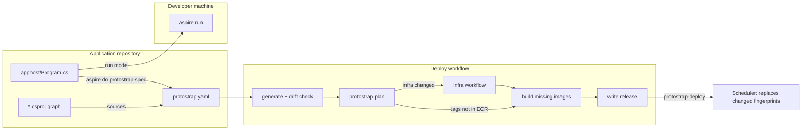

# ProtoStrap with Aspire

[How ProtoStrap is built](protostrap.md) makes one file, `protostrap.yaml`, the whole
description of an application. This page adds a layer on top for .NET applications: the
application is written once, as an [Aspire](https://aspire.dev) AppHost, which runs it on a
developer's machine with `aspire run` and generates `protostrap.yaml` with `aspire publish`.
It also describes how each commit is reduced to what it actually changed, so a release
builds, replaces and provisions only that.

Nothing below the spec changes. Terraform, the scheduler, the agents and `protostrap check`
still read `protostrap.yaml`, and none of them knows Aspire exists. The examples come from
ProtoFast, whose AppHost already describes its services, workers, databases and queues.


## Why

An Aspire application already has two descriptions of itself: the AppHost, which runs it
locally, and whatever deploys it. ProtoFast deploys with 19 `deploy-*.yml` workflows, most of
which list by hand both the paths that trigger them and the paths hashed into the image tag.
Those lists restate the MSBuild project graph, and they drift from it in both directions:

- **Too much.** `deploy-payments.yml` hashes all of `services/shared`, but payments references
  only `ServiceDefaults`, so a change to `shared/Storage` rebuilds and restarts payments for
  nothing. `deploy-api.yml` hashes all of `services/document_import` and `services/api`,
  including the worker, `Screenplay` and the test projects, none of which the API references.
- **Too little.** The root `nuget.config`, which every .NET build reads, is in none of them.
  When a project gains a reference, someone has to remember to add it: `deploy-api.yml`
  carries a comment explaining why `document_import` is in its list.
- **Path filters decide what deploys.** A workflow runs when a push touches its paths. If a
  deploy fails and the next push doesn't touch those paths, the component stays on the old
  image until someone notices.

The AppHost already knows the resources, how they reference and wait for each other, their
endpoints and their environment. MSBuild knows the project graph. The generator joins the
two, so the deploy side is derived instead of restated.


## Design rules

1. **The AppHost is the source; the spec is generated.** Developers edit
   `apphost/Program.cs`. `protostrap.yaml` is written by `aspire publish`, committed, and
   never edited by hand.
2. **Same commit, same spec.** Generation is deterministic: a fixed key order,
   repository-relative paths, no timestamps, no generated passwords, no allocated ports. A
   diff in the spec always means a real change.
3. **The spec changes when the topology does, not when the code does.** Image tags aren't in
   the spec. They are computed at deploy time from each component's sources, as today, so a
   code-only commit leaves `protostrap.yaml` untouched.
4. **Inputs are derived, not declared.** The generator writes each built component's sources
   into the spec from the MSBuild graph. Only what MSBuild can't see, such as a client's
   generated protobuf code, is declared, once, next to the resource in the AppHost.
5. **What changed is decided against what exists, never against the last commit.** Images
   are built only if their tag isn't in ECR. Replicas are replaced only if their fingerprint
   differs from the running one. Terraform runs only if its part of the spec differs from the
   last apply. No step diffs one commit against the one before it.
6. **Each field changes only what it must.** A new image or replica setting replaces
   replicas; a new route reloads the edge; a new scale setting changes a count; a new queue,
   bucket, pool or permission runs Terraform (see [Change classes](#change-classes)).
7. **Run and publish share one graph.** Dev-only resources are excluded from publish.
   ProtoStrap-only settings are annotations that `aspire run` ignores.


## Components

| Component                               | What it is                                                                       | Where it runs                |
| --------------------------------------- | -------------------------------------------------------------------------------- | ---------------------------- |
| [AppHost](#the-apphost)                 | `apphost/Program.cs`: the application                                            | The application's repository |
| [ProtoStrap.Hosting](#the-generator)    | NuGet package: the ProtoStrap environment, `PublishAsProtoStrap*`, the generator ([`hosting/`](../hosting/README.md)) | Referenced by the AppHost    |
| [Spec](#a-generated-spec)               | `protostrap.yaml`, generated and committed                                       | The repository's root        |
| [`protostrap plan`](#protostrap-plan)   | New command: tags, fingerprints, and what a release changes                      | Deploy workflow, laptops     |
| [Deploy workflow](#the-deploy-workflow) | One workflow: generate, check, plan, infra if needed, build what's missing       | GitHub                       |




## The AppHost

### The ProtoStrap environment

The AppHost adds one ProtoStrap environment. It is an Aspire compute environment
(`IComputeEnvironmentResource`): in publish mode, Aspire assigns every compute resource to
it, and it adds a pipeline step, `protostrap-spec`, that writes the spec. In run mode it does
nothing.

```csharp
var protostrap = builder.AddProtoStrapEnvironment("protostrap", app: "protofast")
    .WithVersion("1.4.0")
    .WithHost("app", "protofast.dev", local: "app.dev.localhost")
    .WithHost("auth", "auth.protofast.dev", local: "auth.dev.localhost")
    .WithHost("admin", "admin.protofast.dev", local: "admin.dev.localhost")
    .WithIngressPool(vm: "c8g.medium")
    .WithGeneralPool(vm: ["m7g.large", "m6g.large", "m8g.large", "m7gd.large"],
        min: 1, max: 6, spare: 1, target: 0.70)
    .WithComputePool(vm: ["c7g.xlarge", "c6g.xlarge", "c8g.xlarge", "c7gd.xlarge"],
        min: 0, max: 4)
    .WithDataPool(vm: "m7g.xlarge", count: 1)
    .WithEdge(cpu: "500m", memory: "256Mi");
```

Its settings become the spec's top-level keys: `app`, `protostrap`, `hosts`, `pools` and
`edge`. The pools are the four in [Spec](protostrap.md#spec): a scaling pool lists VM types
of one shape, and every type is Graviton (arm64), from the burstable t4g up
([VM types](vms.md#vm-types)). The edge must fit the ingress pool's VM. Hosts,
routes and sizes on this page are illustrative.

### Component kinds

Each compute resource says what kind of component it is with a `PublishAsProtoStrap*` method,
in the style of Aspire's own `PublishAsDockerComposeService` and `PublishAsAzureContainerApp`.
The callback only runs in publish mode.

```csharp
var postgres = builder.AddPostgres("postgres")
    .PublishAsProtoStrapStateful(s => s
        .Vm("data-1")
        .Request(cpu: "2000m", memory: "8Gi")
        .Volume(size: "100Gi"));

var api = builder.AddProject<Projects.ProtoFast_Api>("api")
    .WithReference(redis).WaitFor(redis)
    .WithReference(protofastDb, connectionName: "protofast").WaitFor(protofastDb)
    .WithReference(documents)
    .WithReference(documentImportQueue)
    .WaitForCompletion(protofastMigrations)
    .PublishAsProtoStrapService(s => s
        .Request(cpu: "500m", memory: "512Mi")
        .Routes("app/api/")
        .Ready(Readiness.Grpc)
        .Stop(TimeSpan.FromSeconds(30))
        .Scale(min: 2, max: 10, demand => demand.Cpu(0.70)));

builder.AddProject<Projects.ProtoFast_DocumentImport_Worker>("document-import")
    .WithReference(protofastDb, connectionName: "protofast").WaitFor(protofastDb)
    .WithReference(documents)
    .WithReference(documentImportQueue)
    .WithReference(workflowOutcomes)
    .WithEnvironment("DocumentImport_Conversion__BaseUrl", conversion.GetEndpoint("http"))
    .PublishAsProtoStrapWorker(w => w
        .Pool(Pool.Compute)
        .Request(cpu: "1000m", memory: "1Gi")
        .Stop(TimeSpan.FromSeconds(120))
        .Scale(min: 0, max: 20, demand => demand
            .Queue(documentImportQueue, rate: 2, drain: TimeSpan.FromSeconds(60))));
```

| Method                        | Kind     | Settings                                                            |
| ----------------------------- | -------- | ------------------------------------------------------------------- |
| `PublishAsProtoStrapService`  | service  | `pool`, `request`, `routes`, `ready`, `metrics`, `stop`, `scale`, `secret_files` |
| `PublishAsProtoStrapWorker`   | worker   | `pool`, `request`, `metrics`, `stop`, `scale`, `secret_files`       |
| `PublishAsProtoStrapStateful` | stateful | `vm`, `request`, `volume`, `backup`, `secret_files`                 |
| `PublishAsProtoStrapTask`     | task     | `pool`, `request`, `secret_files` (see [Migrations as tasks](#migrations-as-tasks)) |

The rest of each component, from its build to its `uses`, `env` and `secrets`, comes from the
app model (see [Mapping](#mapping)).

A compute resource with no `PublishAsProtoStrap*` call fails generation, naming the resource.
A default would hide a missing request or scale rule until production. On PostgreSQL and
Redis, `PublishAsProtoStrapStateful` fills in what the integration knows: the port, the data
path as the volume's `path`, and the dump command as `backup`. The `vm`, the `request` and
the volume's `size` are still set by hand.

Both integrations pass a generated password as a secret parameter, which an upstream image
can't read from the environment's secret. So the generator gives each its password as a
[secret file](secrets.md#secret-files), `POSTGRES_PASSWORD` or `REDIS_PASSWORD`, and a hook
that applies a new one in place ([PostgreSQL and Redis](secrets.md#postgresql-and-redis)).
PostgreSQL reads it with `POSTGRES_PASSWORD_FILE`; Redis's command reads it, through the
image's own entrypoint. A command of your own for Redis must read it too, and the generator
warns that it should.

Any other image that can't read the environment's secret, such as Keycloak's, asks for the
same with `SecretFiles()`. Each key in its `secrets`, from a secret parameter or a
connection string in its environment, becomes a file such as `/run/secrets/KC_DB_PASSWORD`,
which its entrypoint reads. A new value replaces its replicas, unless
`SecretFiles(SecretChange.Reload)` has it read the files again itself, or
`SecretFiles(SecretChange.Run(...))` runs a command in it. A stateful component from an
upstream image may then take a secret too: without `SecretFiles()`, the generator rejects it.

### Queues and buckets

In ProtoFast, the queues and the upload bucket are `const string` names handed to LocalStack.
ProtoStrap.Hosting makes them resources:

```csharp
var documents           = builder.AddProtoStrapBucket("documents", browser: true,
                              versions: TimeSpan.FromDays(7), locked: true);
var documentImportQueue = builder.AddProtoStrapQueue("protofast-document-upload");
var workflowOutcomes    = builder.AddProtoStrapQueue("protofast-workflow-outcomes", fifo: true);
```

In run mode each one is backed by LocalStack, as `WithLocalStackS3` and `WithLocalStackSqs`
do today. In publish mode:

- **A queue** becomes an entry under `queues`, which the
  [infra workflow](protostrap.md#infra-workflow) turns into an SQS queue with its dead-letter
  queue.
- **A bucket** becomes an entry under `buckets`, with its
  [settings](protostrap.md#spec): `browser`, `versions`, `lock` (`locked:` here, since `lock`
  is a C# keyword) and `expire`. ProtoFast's uploads and the Markdown converted from them
  already share one bucket, which is versioned and locked for its frozen run artifacts, and
  which browsers upload to with a signed POST, so it maps as it is.
- **`AddProtoStrapFiles()`** is the files bucket instead, which the infra workflow creates
  for every application, with none of those settings.
- **`WithReference`** adds the queue or the bucket to the component's `uses`, from which its
  [role](identity.md#component-roles) is built. The queue a worker's own `Queue(...)` signal
  reads is left out, since the signal already lets the worker receive from it.

The component reads a queue's URL from `QUEUE_<NAME>_URL`, a bucket's name from
`BUCKET_<NAME>`, and the files bucket's from `FILES_BUCKET`. ProtoStrap sets them in every
replica ([Application contract](protostrap.md#application-contract)), and `WithReference`
sets them to LocalStack's in run mode, where a bucket is versioned and locked as the spec
says. LocalStack keeps every object and answers every origin, so `expire` and `browser` only
apply in an account.

### Dev-only resources

Resources that only make sense locally, such as LocalStack, smtp4dev, pgAdmin and the seeding
scripts, are left out of publish with Aspire's `ExcludeFromManifest()`, or not added in
publish mode at all, as ProtoFast's `IsPublishMode` checks already do. The generator never
sees them.

Two kinds of resource are replaced rather than excluded:

- **A gateway.** ProtoStrap's [edge](protostrap.md#edge), cloudflared and Envoy on each
  zone's ingress VM, is the gateway in an account, and its Envoy is the gateway under
  `aspire run` too ([The local edge](#the-local-edge)). An application's own Envoy or YARP
  for local routing is excluded from publish, or dropped: each service's `Routes(...)` and
  `Authorize(...)` route it in both.
- **Bind mounts.** A replica can't mount the repository. Files the program reads once, such
  as Keycloak's themes and providers, go into the image. Files it reloads become
  [config files](config.md) with `WithProtoStrapConfig`, which is a read-only bind mount
  under `aspire run` too. Config kept in the program's database, such as Keycloak's realms,
  is applied by a [configure task](config.md#configure-tasks) named with
  `WithProtoStrapConfigure`.

### What the generator rejects

Generation fails, listing every resource at fault, when:

- an image has no tag, or the tag is `latest`;
- a service or worker runs an upstream image without a Dockerfile (see [Mapping](#mapping));
- a resource has a bind mount other than its config files from `WithProtoStrapConfig`, or
  container runtime arguments, such as `--network=host`;
- an `AddExecutable` resource isn't excluded from publish;
- a resource uses `WithReplicas` (its `scale` sets that), or `WithEntrypoint`;
- a secret parameter would be written into a plain environment variable (see
  [References, endpoints and secrets](#references-endpoints-and-secrets)), or a component
  with `SecretFiles()` has no secret to write;
- a service, worker or task has a volume, or a stateful component more than one;
- a Dockerfile isn't called `Dockerfile`, builds a stage, takes build arguments, or isn't in
  the repository;
- a project has no `global.json` at or above it, inside the spec's directory, that sets
  `sdk.version`, since ProtoStrap never picks a .NET SDK;
- a variable refers to a resource excluded from publish;
- a compute resource has no `PublishAsProtoStrap*` call, or its settings are missing or
  malformed, such as a request that isn't CPU and memory.

`protostrap check` then runs its own checks on the result, as before: requests that don't fit
a VM, stateful components that don't fit their data VM together, overlapping routes, unknown
names and dependency cycles. The `protostrap-spec` step runs it itself when `protostrap` is
on the `PATH`.


## From the app model to the spec

### Mapping

| AppHost                                       | `protostrap.yaml`                                               |
| --------------------------------------------- | --------------------------------------------------------------- |
| `AddProject<T>("api")`                        | Component `api`, with `project` and `sources` from MSBuild      |
| `AddDockerfile("x", dir)`                     | `build: dir`, with its context as `sources`                     |
| `AddContainer("x", image, tag)`               | `image: image:tag`, stateful only                               |
| `AddPostgres`, `AddRedis`                     | `kind: stateful`, with `port`, `volume` and `backup` filled in  |
| `AddDatabase`                                 | Nothing: a database belongs to its server's component           |
| `WaitFor(x)`                                  | `depends_on: [x]` (a database's server, for a database)         |
| `WaitForCompletion(task)`                     | `migrate: task`                                                 |
| `WithReference(queue)`                        | `uses: [queue]`, unless it is the queue the component scales on |
| `WithReference(bucket)`                       | `uses: [bucket]`                                                |
| `WithReference(files)`                        | `uses: [files]`                                                 |
| `AddProtoStrapEmail("email", domains)`        | `email: { domains: [...] }` ([Email](email.md))                 |
| `WithReference(email)`                        | `uses: [email]`, and no variable in either mode                 |
| `WithEnvironment("K", "v")`                   | `env: { K: v }`                                                 |
| `WithEnvironment("K", x.GetEndpoint("http"))` | `env: { K: http://x:8080 }`                                     |
| `WithReference(db)`, a secret parameter       | A key in `secrets`, never a value                               |
| `WithHttpEndpoint(targetPort: 8080)`          | `port: 8080`                                                    |
| `WithHttpHealthCheck("/healthz")`             | `ready: /healthz`, or `9000/healthz` on another endpoint's port |
| `Ready(Readiness.Grpc.On(9001))`              | `ready: grpc:9001`, on a service, worker or stateful component  |
| `Ready(Readiness.Command("pg_isready"))`      | `ready: [pg_isready]`                                           |
| `Protocol(GatewayProtocol.Http2)`             | `protocol: http2`                                               |
| `Authorize(auth, path: "/auth/check", headers: ["x-user"], forward: ["cookie"])` | `authorize: { by: auth, ... }` ([Authorizing requests](protostrap.md#authorizing-requests)) |
| `WithDataVolume()`                            | The volume's `path`, stateful only                              |
| `WithProtoStrapConfig("../config/x", "/etc/x")` | `config: { from: config/x, path: /etc/x }`, and a read-only bind mount under `aspire run` |
| `OnConfigChange(ConfigChange.Reload)`         | `on_config_change: reload`, or a command with `ConfigChange.Run(...)` |
| `WithProtoStrapConfigure(task)`               | `configure: task`, and the task's `depends_on` the component    |
| `SecretPrefix("Idp_")`                        | `secret_prefix: Idp_`                                           |

JavaScript and Python apps publish through their own Dockerfile and map like
`AddDockerfile`. The Dockerfile Aspire generates for them when it publishes isn't in the
repository, so the generator rejects it, naming the directory to add one to. So does a service or worker from an upstream image,
such as Keycloak: ProtoStrap builds every service and worker, and only a stateful component
runs an upstream image as it is, which the
[deploy workflow](protostrap.md#deploy-workflow) copies into ECR.

### References, endpoints and secrets

When a resource refers to another's endpoint, Aspire asks the compute environment what that
endpoint's address will be once deployed (`GetHostAddressExpression`). The ProtoStrap
environment answers with the component's name on the
[overlay network](protostrap.md#overlay-network) and its `port`. So
`conversion.GetEndpoint("http")` renders as `http://conversion:8090`, the address every
replica resolves on any VM.

A project resolves the endpoints it references on the host's network, and a container on
Aspire's container network. Both render the same: every replica reaches every other on the
overlay. An endpoint with no target port, such as the `https` endpoint a project's launch
profile gives it, has nothing listening on it in a replica, so a variable that refers to it is
left out, with a warning.

Values that contain a secret are never rendered. A connection string goes into the
component's `secrets` list by key, such as `ConnectionStrings__protofast`, and its value
lives only in the environment's secret, under the component's prefix or `Shared_`, where an
Org Admin sets it ([Secrets](secrets.md)). Connection strings always go to the secret, with or
without a password, so moving PostgreSQL to RDS only changes the secret
([application contract](protostrap.md#application-contract), rules 3 and 4). So does anything
holding a parameter, secret or not, or another endpoint of a resource with a connection
string.

Aspire 13's `WithReference` also adds each connection property beside the connection string,
such as `PROTOFAST_HOST` and `PROTOFAST_DATABASENAME`. Each is a connection detail, so each
goes to the secret too. A component that reads only the connection string, as ProtoFast's
do, says so with Aspire's own
`WithReferenceEnvironment(ReferenceEnvironmentInjectionFlags.ConnectionString | ReferenceEnvironmentInjectionFlags.ServiceDiscovery)`,
which leaves its secret with one key per connection.

A key still missing at deploy time stops the new replicas from becoming ready, and the
release rolls back ([Deploy a release](protostrap.md#deploy-a-release)). A secret file that's
missing fails its replica at once, naming the key.

### Migrations as tasks

ProtoFast runs each database's migrations as a project of their own (`WithSchemaMigrations`),
which today's workflows ship as a "companion" of the service, from the same paths and with
the same tag. With ProtoStrap.Hosting the migrations project is a task:

```csharp
var protofastMigrations = builder.AddProject<Projects.ProtoFast_SchemaMigrations>("protofast-db-migrations")
    .WithReference(protofastDb, connectionName: "protofast").WaitFor(protofastDb)
    .PublishAsProtoStrapTask(t => t.Request(cpu: "250m", memory: "256Mi"));
```

The API waits for it with `WaitForCompletion(protofastMigrations)`, as in
[Component kinds](#component-kinds).

A task has its own sources and its own tag. It runs once, in a release in which its tag is
new, before any new replica of a component that waits for it, and the rollout carries on
only if it exits with 0. A release that changes only the API doesn't rerun the migrations.
One that changes only the migrations runs them and replaces nothing, which is safe because
migrations stay compatible with the running release (contract rule 7).

The spec's `migrate` command stays for applications whose migrations ship inside the
service's own image. It runs when that component's image changes.

### A generated spec

```yaml
# Generated by ProtoStrap.Hosting 1.4.0 from apphost/ProtoFast.AppHost.csproj.
# Do not edit: change the AppHost, then run `aspire do protostrap-spec`.
app: protofast
protostrap: 1.4.0
hosts:
  admin: admin.protofast.dev
  app: protofast.dev
  auth: auth.protofast.dev

pools:
  ingress: { vm: c8g.medium }
  general:
    vm: [m7g.large, m6g.large, m8g.large, m7gd.large]
    min: 1
    max: 6
    spare: 1
    target: 70%
    reserved: { cpu: 400m, memory: 1Gi }
  compute:
    vm: [c7g.xlarge, c6g.xlarge, c8g.xlarge, c7gd.xlarge]
    min: 0
    max: 4
    spare: 0
    target: 85%
    reserved: { cpu: 400m, memory: 1Gi }
  data: { vm: m7g.xlarge, count: 1 }

edge:
  request: { cpu: 500m, memory: 256Mi }

queues:
  protofast-document-upload: {}
  protofast-workflow-outcomes: { fifo: true }

buckets:
  documents: { browser: true, versions: 7d, lock: true }

components:
  api:
    kind: service
    project: services/api/src/ProtoFast.Api/ProtoFast.Api.csproj
    sources:
      - global.json
      - nuget.config
      - services/api/src/ProtoFast.Api
      - services/api/src/ProtoFast.Data
      - services/document_import/src/ProtoFast.DocumentImport.Core
      - services/document_import/src/ProtoFast.DocumentImport.Data
      - services/document_import/src/ProtoFast.DocumentImport.Engine
      - services/document_import/src/ProtoFast.DocumentImport.Storage
      - services/shared/Database
      - services/shared/Database.Abstractions
      - services/shared/Exceptions
      - services/shared/Grpc
      - services/shared/ServiceDefaults
      - services/shared/Storage
      - services/shared/Storage.Abstractions
    pool: general
    request: { cpu: 500m, memory: 512Mi }
    port: 8080
    ready: grpc
    routes: [app/api/]
    depends_on: [postgres, redis]
    uses: [documents, protofast-document-upload]
    migrate: protofast-db-migrations
    env:
      Api_Sqs__DocumentImport__QueueName: protofast-document-upload
    secrets: [ConnectionStrings__protofast, ConnectionStrings__redis]
    stop: 30s
    scale: { min: 2, max: 10, demand: [{ cpu: 70% }] }

  payments:
    kind: service
    project: services/payments/src/ProtoFast.Payments.Api/ProtoFast.Payments.Api.csproj
    sources:
      - global.json
      - nuget.config
      - services/payments/src/ProtoFast.Payments.Api
      - services/shared/ServiceDefaults
    # …

  protofast-db-migrations:
    kind: task
    project: services/api/src/ProtoFast.SchemaMigrations/ProtoFast.SchemaMigrations.csproj
    sources:
      - global.json
      - nuget.config
      - services/api/src/ProtoFast.Data
      - services/api/src/ProtoFast.SchemaMigrations
      # … and the projects they reference
    pool: general
    request: { cpu: 250m, memory: 256Mi }
    depends_on: [postgres]
    secrets: [ConnectionStrings__protofast]

  postgres:
    kind: stateful
    image: postgres:18.3
    vm: data-1
    request: { cpu: 2000m, memory: 8Gi }
    port: 5432
    volume: { path: /var/lib/postgresql, size: 100Gi }
    backup: [pg_dumpall, -U, postgres]
```

`sources` are one per line, so a new project reference is a one-line diff that a reviewer
sees. The API's list is exactly its reference closure: it leaves out the document-import
worker, `Screenplay`, `History` and every test project, which today's `hash_paths` include.
Payments now depends on two directories instead of all of `services/shared`.

The API's `uses` comes from its two `WithReference` calls. A new reference is a one-line diff
too, and it changes the API's role, so a reviewer sees every new permission.

### The generator

The `protostrap-spec` step runs inside the AppHost in publish mode, after Aspire has built the
app model:

```csharp
public static IResourceBuilder<ProtoStrapEnvironmentResource> AddProtoStrapEnvironment(
    this IDistributedApplicationBuilder builder, string name, string app)
{
    var environment = new ProtoStrapEnvironmentResource(name, app);
    return builder.AddResource(environment)
        .ExcludeFromManifest()
        .WithPipelineStepFactory(_ => new PipelineStep
        {
            Name = "protostrap-spec",
            Description = "Writes protostrap.yaml from the app model",
            Action = step => ProtoStrapSpecWriter.WriteAsync(environment, step),
            RequiredBySteps = [WellKnownPipelineSteps.Publish],
        });
}
```

1. **Collect.** Every resource in the model that isn't excluded from publish and is deployed
   to this environment.
2. **Resolve.** Each resource's environment and arguments, in the publish context. Endpoint
   references render through the environment; references to queues and files become `uses`;
   anything holding a secret parameter becomes a key in `secrets`.
3. **Trace inputs.** For each project, an MSBuild evaluation of its reference closure (see
   [Image tags](#image-tags)).
4. **Write.** Canonical YAML, only if it changed, then `protostrap check` on it, with a
   warning first if that `protostrap` isn't the AppHost's version (see
   [The local edge](#the-local-edge)).

The step doesn't depend on Aspire's `process-parameters` step. It writes parameter names,
never values, so generating the spec needs no secrets and runs unattended in CI. When it
fails, it lists every problem and writes nothing, and the AppHost exits with 1, so
`dotnet run --project apphost -- --operation publish --step protostrap-spec` fails as `aspire
do protostrap-spec` does.


## Only deploying what changed

### Three questions

Every release answers three questions, each by comparing content hashes with what already
exists:

| Question                         | Compares                                                | Decides     |
| -------------------------------- | ------------------------------------------------------- | ----------- |
| Which images must be built?      | Each built component's tag with the tags in ECR         | Build, push |
| Which replicas must be replaced? | Each component's fingerprint with its running replicas' | Rollout     |
| Must infrastructure change?      | The spec's infra projection with the last apply         | Terraform   |

None of them compares a commit with the one before it. That comparison is wrong whenever
commits are batched, a deploy failed, or a release is rolled back. Comparing with what exists
is right in all three: a failed component's new tag is still missing from the running
release next time, and a rollback finds every image it needs in ECR already.

### Image tags

```
sources hash = git ls-files -s -- <sources> | git hash-object --stdin
recipe       = build kind, project or Dockerfile path, SDK version, platform,
               base image digest, ProtoStrap.Hosting version
tag          = "c-" + the first 16 hex digits of sha256(sources hash, recipe)
```

- **Git has already hashed the content.** `git ls-files -s` lists each tracked file's blob
  hash, so a tag costs milliseconds and needs no build. ProtoFast's `_component-deploy.yml`
  uses the same line today. What changes is where the paths come from.
- **Only tracked files count**, so `bin/`, `obj/` and `node_modules/` never move a tag.
- **SDK-style projects include their whole directory** by default, so hashing a project's
  directory is what MSBuild compiles, not an over-approximation.
- **What MSBuild sees, the generator sees.** Besides each project in the `ProjectReference`
  closure, `sources` holds every MSBuild file the evaluation imported from inside the
  repository (`Directory.Build.props`, `Directory.Packages.props`), `nuget.config`,
  `global.json`, package lock files, and every item (`Compile`, `Content`, `Protobuf`,
  `EmbeddedResource` and so on) whose path is outside its project's directory, such as a
  `.proto` linked from a shared folder.
- **Pin floating inputs.** A base image such as `aspnet:10.0` moves when it is patched.
  Unpinned, it makes a tag depend on when you deploy rather than what you committed.
  `protostrap plan` still resolves the base image's digest and puts it in the recipe, so a
  patch rebuilds, but nothing in the repository says why. Pinned by digest in
  `ContainerBaseImage`, a patch is a commit that rebuilds every .NET component, which is what
  it is. The generator warns about it.
- **The SDK can't float.** ProtoStrap never picks a .NET SDK, so a new .NET needs no new
  ProtoStrap: a project builds with the one the nearest `global.json` at or above it pins.
  The generator and `protostrap plan` refuse a project without one inside the spec's
  directory, tracked, that sets `sdk.version`. Plan adds it to the tag's sources whether or
  not the spec lists it, so an SDK bump is a commit that rebuilds every .NET component.
- **Builds outside MSBuild declare their extras.** A Dockerfile's sources are its build
  context, minus `.dockerignore`. A JavaScript app's are its directory and lock file. Anything
  else is declared on the resource: ProtoFast's clients generate code from protobuf files
  with buf, so they declare `.WithProtoStrapSources(":(glob)services/**/Protos/**")`. It is the
  one hand-written input list left, and it sits next to the resource it describes.
- **Tests aren't sources.** A test-only change runs the tests and deploys nothing.

The deploy workflow builds and pushes an image only if its tag isn't in ECR: the existing
rule from [Deploy workflow](protostrap.md#deploy-workflow), now with accurate tags.

### Component fingerprints

A tag says whether an image is new. It doesn't say whether replicas must be replaced: a new
`env` value needs new replicas of the same image. So every component in a release also gets a
fingerprint:

```
fingerprint = sha256(canonical JSON of the component's replica-shaping fields)
```

The replica-shaping fields are the ones that end up in a replica's
[assignment](protostrap.md#sync): the image tag, `request`, `port`, `ready`, `stop`, `env`,
`secrets`, `metrics` and `volume`. A change to `secrets` counts, because a replica only reads
its secret when it starts. A change to `uses` doesn't: it changes the component's role, which
Terraform updates in place, and running replicas get the new permissions without restarting.
Nor do ProtoStrap's own variables: a new queue's `QUEUE_<NAME>_URL` reaches new replicas
without replacing the rest, which don't send to it.

The release records each component's fingerprint, and the agent labels each replica with it
(`protostrap.fingerprint`). During a rollout, the scheduler replaces a component's replicas
only where the release's fingerprint differs from theirs. A replica of an older release with
a matching fingerprint is kept as it is.

Because endpoint references are rendered into `env`, a change spreads exactly as far as it
should. Changing the conversion service's port changes `conversion` and every component whose
`env` holds its address, and nothing else.

### Change classes

| A commit changes                                                | Build                        | Replicas                                   | Edge                         | Infra                                   |
| --------------------------------------------------------------- | ---------------------------- | ------------------------------------------ | ---------------------------- | --------------------------------------- |
| A component's sources                                           | Its image                    | Its own, a quarter at a time               | —                            | —                                       |
| A stateful component's `image`                                  | Copied into ECR              | Its own                                    | —                            | —                                       |
| `request`, `port`, `ready`, `stop`, `env`, `secrets`, `metrics` | —                            | Its own                                    | —                            | —                                       |
| A task's sources                                                | The task's image             | None; the task runs once                   | —                            | —                                       |
| `routes`, or a route's `rate`                                   | —                            | —                                          | Routes file, no restart      | —                                       |
| `scale`, or a pool's `spare`, `target` or `reserved`            | —                            | Counts change on the next cycle            | —                            | —                                       |
| `uses`, or the queue a `queue` signal reads                     | —                            | —                                          | —                            | The component's role                    |
| `depends_on`                                                    | —                            | — (order of first starts only)             | —                            | —                                       |
| `backup`                                                        | —                            | — (the agent's schedule)                   | —                            | —                                       |
| A stateful component's volume `size`                            | —                            | —                                          | —                            | Its EBS volume                          |
| A component added                                               | Its image                    | Started                                    | Its routes                   | ECR repository, secret, log group, role |
| A component removed                                             | —                            | Stopped                                    | Its routes removed           | Kept until a cleanup                    |
| `hosts`, `queues`, `buckets`, a pool's VM types, minimum, maximum or count | — | — | — | Terraform |
| `edge`                                                          | —                            | —                                          | Replaced, beside the old one | —                                       |
| The `protostrap` version                                        | Binary and edge image copied | The scheduler and agents update themselves | Replaced, beside the old one | —                                       |

Replacing a stateful component stops it before starting the new one, so it is briefly
unavailable ([Deploy a release](protostrap.md#deploy-a-release)). `protostrap plan` flags
every stateful replacement. A new edge starts beside the old one on the same ingress VM, so
requests never pause ([Edge](protostrap.md#edge)). A new `protostrap` version updates the
scheduler first, then the agents on their next sync.

A removed component's ECR repository, secret, role and queues are kept, so a rollback still
works and no queued job is lost. Deleting them is a separate, explicit change to the
Terraform config.

### Infrastructure projection

Terraform reads only part of the spec: `hosts`; each pool's VM types, minimum, maximum and
count; `queues`; `buckets`; and, per component, its name and kind, its `uses` and `queue` signals, and a
stateful component's `vm` and volume `size`. From these it makes each component's ECR
repository, secret, log group, [role](identity.md#component-roles) and EBS volume.
`protostrap plan` hashes that part. After a successful apply, the infra workflow writes the
hash it applied to the deploy bucket, as `infra/<environment>.sha256`.

The deploy workflow runs the infra workflow only when the two differ, and before it builds,
because a new component's ECR repository must exist before its image is pushed. A change to a
component's `env`, or to a pool's `target`, changes the spec but not the projection, so it
never waits on a Terraform plan or on a production approval for infrastructure.

### `protostrap plan`

`protostrap plan` puts the three answers together. It reads the generated spec, the tags in
ECR, the infra hash, and the last good release from the deploy bucket:

```
$ protostrap plan --environment prod
release 7c1d2e0 against 9f2c1e7 (prod, last good)

infra                     unchanged
api                       rebuild    c-4e1a90b2 → c-91f0d3aa   services/shared/Storage/S3BlobStore.cs
document-import           rebuild    c-0c2d7710 → c-5be1f4c9   services/shared/Storage/S3BlobStore.cs
                          scale      max 20 → 30
auth                      replace    c-a3310be4                env Auth_Smtp__From
edge                      reload     + protofast.dev/v2/ → api
protofast-db-migrations   unchanged
payments, keycloak, postgres, redis, otel-collector   unchanged

build 2 images · replace 3 components · run 0 tasks · infra unchanged
```

- **The reason column** comes from `git diff --name-only` between the two releases' commits,
  limited to the component's `sources`, and from comparing replica-shaping fields.
- **On a pull request**, the plan is posted as a comment, so reviewers see what merging would
  rebuild, restart and provision before it happens. It runs with a read-only role, since a
  pull request mustn't get the Deploy role (see [Changes to ProtoStrap](#changes-to-protostrap)).
- **It is a preview.** The scheduler stays the one component that decides
  ([design rule 2](protostrap.md#design-rules)): it compares fingerprints with the replicas
  actually running, which may differ from the last good release if a rollout was interrupted.


## The deploy workflow

The 19 per-component workflows become one, with no path filters:

```yaml
on:
  push: { branches: [main] }

jobs:
  plan:     # aspire do protostrap-spec, drift check, protostrap check, protostrap plan
  infra:    # needs: plan. Only if the infra projection changed
  build:    # needs: plan, infra. A matrix over the tags missing from ECR
  release:  # needs: build. Copy what's missing, write releases/<commit>.json, send protostrap-deploy
```

1. **Generate and check for drift.** `aspire do protostrap-spec`, then
   `git diff --exit-code protostrap.yaml`. If someone changed the AppHost or a project
   reference without regenerating, the job fails and shows the diff. The reusable `plan`
   workflow does this when its `apphost` input names the AppHost project.
2. **Check.** `protostrap check`. The workflow can't read secrets, so it checks key names,
   never that they are set.
3. **Plan.** `protostrap plan --json` gives the jobs below their inputs: whether infra
   changed, and which tags to build.
4. **Infra**, only if the projection changed. In prod it waits for approval as today.
5. **Build**, one job per missing tag, in parallel. A project builds with the .NET SDK's
   container publish,
   `dotnet publish <project> -t:PublishContainer -p:ContainerImageTag=<tag>`, as ProtoFast
   does today, from the project's directory with the SDK its `global.json` pins. A
   Dockerfile builds with buildx. Each job first runs the test projects whose reference
   closure overlaps the component's sources.
6. **Release.** Copy the `protostrap` binary, the edge image and the stateful components'
   upstream images, if they aren't there yet. Write `releases/<commit>.json` with the spec,
   every component's tag and every fingerprint, then send `protostrap-deploy <commit>`
   through SSM, as in [Deploy workflow](protostrap.md#deploy-workflow).

It runs on every push to `main` in dev, and in prod in the `prod` GitHub environment after
approval, one at a time per environment, as in
[Deploy workflow](protostrap.md#deploy-workflow). A push that changes nothing deployable ends
after `plan`, with nothing to build and no release. Every push still runs `plan`, so a
component left behind by a failed deploy is picked up by the next one, whatever that push
touched.

The workflow doesn't use `aspire deploy`. Aspire 13's own `build` and `push` steps act on
every resource that needs an image and know nothing about what ECR already holds. Keeping
plan, build and release in `protostrap` also means an application without an AppHost deploys
the same way. In CI, the AppHost's only job is writing the spec. On a laptop, `aspire deploy`
can be wired to call `protostrap deploy` for convenience.


## Local development

### The local edge

When the environment has hosts, `aspire run` runs the edge too: a container,
`protostrap-edge`, of the Envoy an account's edge runs (`envoyproxy/envoy` at the edge's
version), configured by the same renderer.

- **It serves each host's local hostname** from `WithHost(..., local: "admin.dev.localhost")`
  on one port, 20000 unless `WithLocalEdge(port: ...)` says otherwise: browsers open
  `http://admin.dev.localhost:20000`. Every resource gets `HOST_<NAME>` with the local
  hostname and `ORIGIN_<NAME>` with `http://` and that port.
- **It routes what the spec routes:** each service's routes, protocol, readiness check, rate
  limits and authorizer, read from the same `PublishAsProtoStrapService` call, so gRPC-Web
  translation, `authorize` and a check that answers only for its own name behave as they
  will in an account.
- **It reaches services where the AppHost runs them:** a project at
  `host.docker.internal` on its port, a container by its name on Aspire's network. Its
  gRPC checks ask for the server as a whole (service `""`), since no replica has
  `PROTOSTRAP_COMPONENT` there; HTTP checks still send the component's name as the host,
  which a service skips testing outside ProtoStrap.
- **The dashboard shows it in front of the application.** Its links are each host's local
  hostname, by the host's name; its endpoint's own URL, `http://localhost:20000`, matches no
  host, so it is left to the details. It references each service it reaches, so the graph
  draws it in front of them. Its console has a line for each request: the method, host and
  path (without the query, which may hold a sign-in's code), the service it went to, the
  status, and Envoy's response flags, such as `UAEX` for a request the authorizer refused,
  `NR` for one no route matched, or `UH` for one no ready replica could take. An account's
  edge doesn't log requests. A service's own URL reaches it directly, past the edge's routing
  and authorization.
- **It is rendered by `protostrap edge render`,** as the container is created, once every
  service it reaches has its address on Aspire's container network: the edge depends on each
  service with routes and each authorizer of one, so Aspire's container tunnel gives each
  project an address first. The AppHost writes the routing to `obj/protostrap-edge/routing.json`
  and the renderer writes Envoy's files beside it, which the container mounts.
- **It renders with the AppHost's own `protostrap`,** which `protostrap-build`, nested under the
  edge on the dashboard, builds from the ProtoStrap checkout ProtoStrap.Hosting is built from
  into `obj/protostrap/`, so it is the AppHost's version. It builds as the AppHost starts,
  before the edge needs it, and again each time the edge starts: Go's build cache makes that a
  no-op, a tenth of a second, when nothing changed, and rebuilds what did. A `protostrap` on
  `PATH` isn't used, so an old one can't render the edge. The build needs Go (on `PATH`, in
  `GOROOT`, or where Go's installer puts it) at the version `go.mod` names, and never
  downloads a toolchain unless `GOTOOLCHAIN` says to. Its state is `Up to date`, or `Build
  failed` with Go's output in its console, and then the edge doesn't start either.
- **It says when the checkout moves on.** Every 5 seconds it looks at the checkout's files that
  go into `protostrap`: `go.mod`, and everything under `cmd/` and `internal/` but tests and
  test data, such as the operator UI's embedded files. Once one changed after the last build
  started, its state is `Behind`, and its console names the file: the edge still renders
  with the `protostrap` from before. Its **Rebuild** command builds `protostrap`, then restarts
  the edge with it; a failed build leaves the edge as it is. Restarting the edge rebuilds too.
- **Otherwise it renders with a `protostrap` the AppHost didn't build**: the one `WithCheck(...)`
  names (`protostrap-build` is hidden then), or, without a checkout (a package) or without Go
  (`protostrap-build` says `Go not found`), `protostrap` on `PATH`. Without one, the edge
  doesn't start, and says what to install. Such a binary may not be the AppHost's version, so
  the edge's console warns when it can tell, and the edge still renders with it. With a
  checkout, the binary must record the checkout's commit (Go writes it into every binary it
  builds in a git checkout; git says the checkout's), and must be newer than every file of the
  checkout that goes into it, as above; Go touches the binary each time it checks one is up to
  date, so its time is when it last matched the source. A binary that doesn't record its
  commit gets a warning too. Without a checkout, `protostrap version` must be
  ProtoStrap.Hosting's version. The `protostrap-spec` step warns the same way before
  `protostrap check`, which always runs the `protostrap` on `PATH`, or the one `WithCheck`
  names.

- **`aspire run` is unchanged.** `PublishAsProtoStrap*` callbacks and the ProtoStrap
  environment do nothing in run mode.
- **Regenerate before committing.** A pre-commit hook runs `aspire do protostrap-spec` when a
  commit touches `apphost/`, any `*.csproj`, or a `Directory.*.props` file, since all of them
  can change the spec. The drift check catches anyone without the hook.
- **See what a branch would deploy** in its pull request's plan comment, or with
  `protostrap plan --environment dev`, once developers can read dev's ECR and deploy bucket
  (see [Changes to ProtoStrap](#changes-to-protostrap)).


## Flows

### Change a shared library

1. A developer edits `services/shared/Storage/S3BlobStore.cs` and pushes. The spec doesn't
   change.
2. `plan` finds new tags for `api` and `document-import`, whose sources include
   `services/shared/Storage`. Every other tag is already in ECR.
3. Two images are built, in parallel, and the release is written.
4. The scheduler replaces `api` and `document-import` replicas, a quarter at a time. Payments,
   auth and everything else keep their replicas.

### Add a queue

1. A developer adds `builder.AddProtoStrapQueue("protofast-thumbnails")`, a worker that
   scales on it, and a `WithReference` to it from the API, which sends the jobs. Then they
   regenerate the spec.
2. The pull request shows the new `queues` entry, the new component and the API's new `uses`
   entry in `protostrap.yaml`, and the plan comment shows the new images and an infra change.
3. On merge, the infra workflow creates the queue and its dead-letter queue, lets the API's
   role send to it, and creates the worker's ECR repository, secret, log group and role,
   which may receive from it. Then the images are built, and the release replaces the API's
   replicas and starts the worker, at zero replicas until a job arrives.

### Add a bucket

1. A developer adds `builder.AddProtoStrapBucket("protofast-exports", expire: TimeSpan.FromDays(7))`
   and a `WithReference` to it from the API, which writes the exports and signs their
   download URLs. Then they regenerate the spec.
2. The pull request shows the new `buckets` entry and the API's new `uses` entry, and the
   plan comment shows the API's new image and an infra change.
3. On merge, the infra workflow creates `protostrap-<account>-<region>-protofast-exports`
   with its expiry rule, and lets the API's role read and write it. Then the release replaces
   the API's replicas, which find the bucket's name in `BUCKET_PROTOFAST_EXPORTS`.

### Change a scale setting

1. A developer raises `document-import`'s maximum from 20 to 30 and regenerates the spec.
2. `plan` finds no new tags, an unchanged infra projection and unchanged fingerprints.
3. The release is written. The scheduler uses the new maximum on its next cycle, and no
   replica restarts.


## Changes to ProtoStrap

This design needs these changes to [How ProtoStrap is built](protostrap.md) and
[Identity](identity.md):

1. **`project` builds.** A component can name a `.csproj` instead of a Dockerfile directory,
   and the deploy workflow builds it with the .NET SDK's container publish.
2. **Files and pathspecs in `sources`**, not only directories.
3. **The build recipe in the tag.** Today the tag hashes only the `build` directory and
   `sources`. The base image, SDK version and platform belong in it too, or must be pinned.
4. **Top-level `queues`.** Today a queue is named only where it is used, in a sender's `uses`
   and a worker's `queue` signal. That is enough to create it, but leaves its own settings
   nowhere to go, so a FIFO queue can't be declared. Under `queues`, each queue has its
   settings, and `uses` and `queue` signals must name one of them.
5. **Receiving through `uses`.** `uses` lets a role send to a queue, and only a `queue` signal
   lets it receive. ProtoFast's document-import both sends to and drains
   `protofast-workflow-outcomes`, which it doesn't scale on, and `WithReference` can't tell
   sending from receiving, so a queue in `uses` needs to allow both.
6. **Top-level `buckets`.** ProtoFast's documents bucket is versioned and locked, which the
   files bucket isn't, and its worker sets retention on what it writes. Under `buckets`,
   each bucket has its settings, `uses` names it, and the Role boundary allows setting an
   object's retention, but never bypassing it.
7. **`kind: task`**, and `migrate` naming a task.
8. **`secrets`**, the key names a component reads from the environment's secret
   ([Secrets](secrets.md)).
9. **Fingerprints** in the release and on every replica. This also settles an ambiguity: the
   scheduler's cycle says it replaces "replicas of an older release", while the deploy
   workflow says unchanged components' "replicas aren't touched". With fingerprints, a
   replica of an older release is kept when its fingerprint matches.
10. **When `migrate` runs.** "Once per release" becomes once per release in which the
    component's image changed.
11. **A read-only plan role.** `protostrap plan` reads ECR's tags and the deploy bucket. The
    Deploy role can also write releases and send the deploy command, so a pull request can't
    be given it. A GitHub Actions role that only reads, trusted for pull requests, runs the
    plan. Developers need the same read access in dev to run it on a laptop.


## Open questions

- **One spec, or one per environment.** protostrap.md keeps one spec and puts each account's
  differences in a small Terraform config. If dev and prod need different pool sizes, the
  generator could write `protostrap.<environment>.yaml` from `aspire publish -e <environment>`,
  at the cost of two files to review.
- **Checking secrets.** No role the deploy workflow has may read a secret, so nothing checks
  that every listed key is set before a deploy. A `protostrap check --secrets`, run by
  whoever sets the values, could, with their credentials. If whoever sets a value also
  tagged the secret with its key names, the Deploy role could compare them with
  `DescribeSecret`, which reads no value.
- **Replacing a component because a dependency changed.** Contract rule 7 keeps releases
  compatible, so nothing is replaced because a component it depends on was. If one ever must
  be, it should say so with an explicit setting, not an implicit cascade.
- **Static clients.** ProtoFast ships some clients as S3 prefixes, not images, and ProtoStrap
  has no kind for static assets. In publish mode ProtoFast serves its clients from the SSR
  host, a container, so it fits as a service. A static kind would need its own change rule:
  upload a prefix, then switch a pointer.
- **Aspire's pipeline API.** `PipelineStep` and `WellKnownPipelineSteps` are new in Aspire 13
  and still change between minor versions. ProtoStrap.Hosting should support a pinned range
  and be tested against each minor version. The spec format, not the Aspire API, is the
  contract that has to stay stable.
