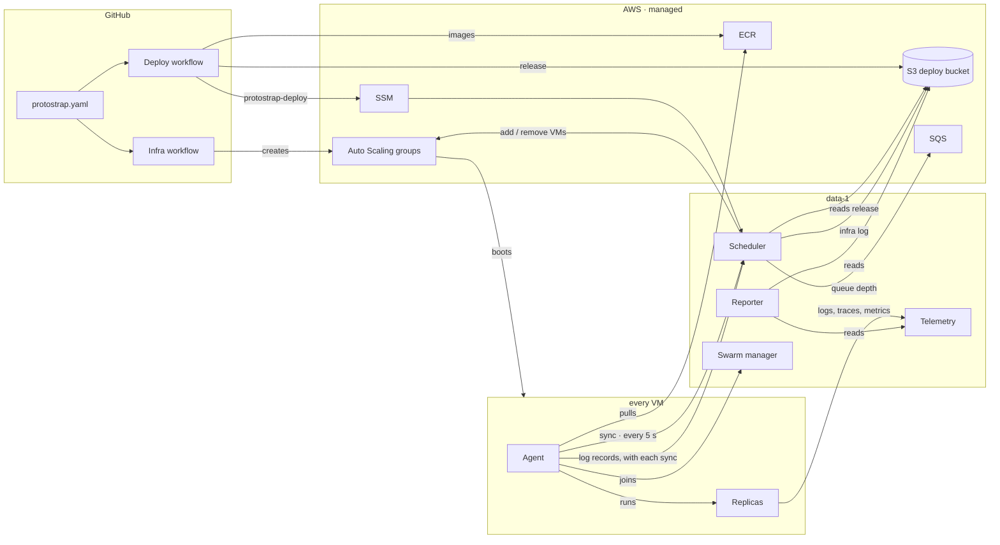
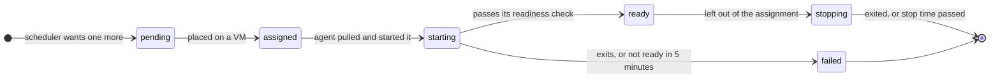
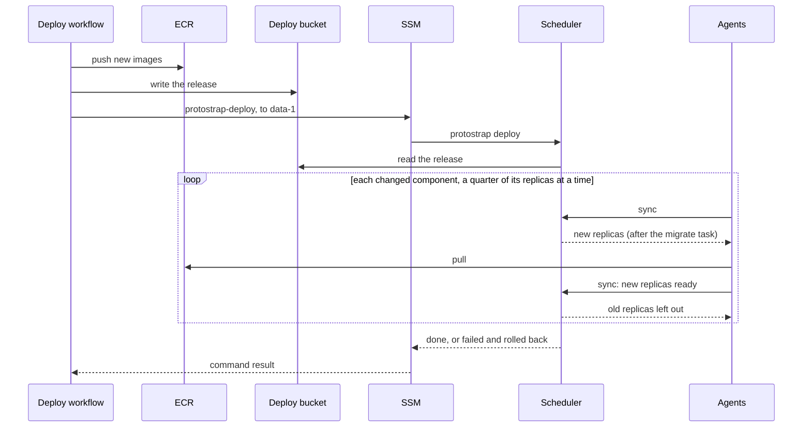

# How ProtoStrap is built

The [README](../README.md) describes what ProtoStrap gives an application: the stack, the VM
pools, and the rules for scaling and placing replicas. This page describes the parts
ProtoStrap is built from, what each one does, and how they work together to deploy an
application and keep it sized to its load. How the VMs run on AWS is in
[VMs on AWS](vms.md), the network in [Network](network.md), and who may do what in AWS in
[Identity](identity.md).


## Design rules

1. **One file describes the application.** `protostrap.yaml`, in the application's
   repository, lists the pools and the components. Terraform reads it to create resources,
   and the scheduler reads it to run replicas.
2. **One component decides.** The scheduler makes every decision: how many replicas, on
   which VM, and how many VMs. Agents carry out its decisions and report what they see.
3. **Decisions are recomputed, not remembered.** Every cycle, the scheduler compares what
   should run with what is running, from scratch. It has no database: the release is a
   file, and what is running is what the agents report. Restarting it loses nothing.
4. **Agents ask; nothing calls them.** Each agent calls the scheduler every 5 seconds and
   gets back the full list of what its VM should run. No component opens a connection to
   an agent, and agents listen on no port.
5. **A replica never changes.** A new image, setting, request or key means a new replica,
   started before the old one stops. The one exception is a replica that takes new keys as
   [secret files](secrets.md#secret-files): its files are data, like the edge's routes.
6. **Down means frozen, not broken.** If the scheduler stops, every replica keeps running
   and serving. Only deploys, scaling and recovery wait for it to return.
7. **Scaling out is automatic; scaling up is advised.** ProtoStrap adds and removes
   replicas and VMs by itself. Bigger requests, bigger VMs and moves to managed services
   are edits to `protostrap.yaml`, made when the [reporter](#reporter) recommends them.


## Components

| Component                           | What it is                             | Where it runs                | How many  |
| ----------------------------------- | -------------------------------------- | ---------------------------- | --------- |
| [Spec](#spec)                       | `protostrap.yaml`                      | The application's repository | 1         |
| [Infra workflow](#infra-workflow)   | Terraform, run by GitHub Actions       | GitHub                       | —         |
| [Deploy workflow](#deploy-workflow) | Builds images and starts a release     | GitHub                       | —         |
| [Scheduler](#scheduler)             | `protostrap scheduler`                 | data-1, the data VM          | Exactly 1 |
| [Agent](#agent)                     | `protostrap agent`                     | Every VM                     | 1 per VM  |
| [Edge](#edge)                       | cloudflared and Envoy in one container | Its zone's ingress VM           | 1 replica per zone |
| [Overlay network](#overlay-network) | Docker Swarm overlay                   | Every VM, manager on data-1  | 1         |
| [Pools](#pools)                     | Auto Scaling groups, fixed instances   | AWS                          | 4         |
| [Reporter](#reporter)               | `protostrap report`                    | data-1                       | Daily job |
| [Operator UI](#operator-ui)         | A read-only page the scheduler serves  | data-1, on loopback          | 1         |
| [Telemetry](#telemetry)             | A collector, Loki, Tempo, Prometheus and Grafana in one container | data-1        | 1 replica |

The scheduler, agent and reporter are commands of one program, `protostrap`, which also
has `check` (validate a spec), `deploy` (start a release) and `status` (show what runs
where). One binary, one version, pinned in the spec.



### Spec

`protostrap.yaml` is the whole application: its pools, its components and the version of
ProtoStrap that runs them. It lives at the root of the application's repository, so a
release is a commit.

```yaml
app: shop
protostrap: 1.4.0
hosts:
  shop: shop.example.com

pools:
  ingress: { vm: c8g.medium }
  general:
    vm: [m7g.xlarge, m6g.xlarge, m8g.xlarge, m7gd.xlarge]
    min: 1
    max: 10
    spare: 1
    target: 70%
    reserved: { cpu: 400m, memory: 1Gi }
  compute:
    vm: [c7g.xlarge, c6g.xlarge, c8g.xlarge, c7gd.xlarge, m7g.xlarge, m6g.xlarge]
    min: 0
    max: 20
    spare: 0
    target: 85%
    reserved: { cpu: 400m, memory: 1Gi }
  data: { vm: m7g.xlarge, count: 1 }

edge:
  request: { cpu: 500m, memory: 256Mi }

telemetry:
  retention: { logs: 30d, traces: 14d, metrics: 15d }

queues:
  orders: { visibility: 5m }

components:
  api:
    kind: service
    build: services/api
    sources: [services/shared]
    pool: general
    request: { cpu: 500m, memory: 512Mi }
    port: 8080
    ready: grpc
    routes: [shop/api/]
    metrics: 9090/metrics
    depends_on: [postgres, redis]
    uses: [orders]
    migrate: [dotnet, Api.dll, migrate]
    stop: 30s
    scale:
      min: 2
      max: 10
      demand: [{ cpu: 70% }]

  orders-worker:
    kind: worker
    build: services/orders-worker
    pool: compute
    request: { cpu: 1000m, memory: 1Gi }
    depends_on: [postgres]
    stop: 120s
    scale:
      min: 0
      max: 20
      demand: [{ queue: orders, rate: 2/s, drain: 60s }]
      limits: [{ metric: llm_budget_cap }]

  postgres:
    kind: stateful
    image: postgres:17.2
    vm: data-1
    request: { cpu: 2500m, memory: 9Gi }
    port: 5432
    volume: { path: /var/lib/postgresql/data, size: 100Gi }
    backup: [pg_dumpall, -U, postgres]

  redis:
    kind: stateful
    image: redis:7.4
    vm: data-1
    request: { cpu: 1000m, memory: 4Gi }
    port: 6379
    volume: { path: /data, size: 20Gi }
    backup: [redis-cli, --rdb, "-"]
```

**Pools.** The ingress pool is one VM of its `vm` type per zone, running only the edge and
the zone's NAT. A scaling pool lists its VM types, all of one shape: sizing assumes the
first, and the others give the Auto Scaling group more capacity to draw on. Compute runs on
Spot, with On-Demand as a fallback. The data pool is a fixed `count` of VMs, `data-1` to
`data-n`; one runs both PostgreSQL and Redis until they outgrow it. Why each pool runs as
it does is in [VM types](vms.md#vm-types).

Each component has a kind: a **service** gets requests from the gateway, a **worker**
takes jobs from a queue, a **stateful** component is pinned to a data VM with a volume, and
a **task** runs to completion once per release, as another component's `migrate`. The edge
isn't listed: ProtoStrap adds it, and only its request can be set. It must fit
the ingress pool's VM. Nor is [telemetry](#telemetry), which ProtoStrap adds on data-1: its
request, volume and retention can be set, and it must fit data-1 beside the stateful
components there ([Settings](telemetry.md#settings)).

| Field        | Kinds             | Meaning                                                                       |
| ------------ | ----------------- | ----------------------------------------------------------------------------- |
| `build`      | service, worker, task | Directory with the Dockerfile. The image tag is a hash of it and of `sources` |
| `project`    | service, worker, task | Instead of `build`: a `.csproj` the .NET SDK publishes as an image, with the SDK the nearest `global.json` at or above it pins. The tag hashes its directory, that `global.json` and `sources` |
| `context`    | service, worker, task | The build context, if not `build`: a parent directory shared by several builds |
| `sources`    | service, worker, task | More files, directories and git pathspecs the image is built from, such as shared code |
| `image`      | stateful          | Upstream image, pinned to a tag                                               |
| `command`    | all               | Replaces the image's command                                                  |
| `pool`       | service, worker, task | `general` or `compute`                                                    |
| `vm`         | stateful          | The data VM it is pinned to                                                   |
| `request`    | all               | CPU and memory one replica reserves                                           |
| `port`       | service, stateful | Port it listens on                                                            |
| `protocol`   | service           | What the gateway speaks to it: `http1`, `http2` (cleartext HTTP/2), or `grpc`, which is HTTP/2 with browsers' gRPC-Web translated for it. It defaults to `grpc` with `ready: grpc`, otherwise `http1` |
| `ready`      | service, worker, stateful | Its [readiness check](#readiness-checks), such as `/healthz`, `9000/health/ready`, `grpc` or a command. Services must have one |
| `routes`     | service           | A [host](#hosts)'s name and a path prefix the gateway sends to it, such as `shop/api/`, each with an optional `rate`. A path alone, such as `/api/`, matches every host |
| `authorize`  | service           | Another service the edge asks about each request to this one's routes first ([Authorizing requests](#authorizing-requests)) |
| `metrics`    | all               | Port and path of a Prometheus endpoint, for `metric` signals and limits       |
| `depends_on` | all               | Components that must have a ready replica before this one starts              |
| `uses`       | all               | Queues it sends to, buckets it reads and writes, `files` or `backups` for those buckets, and `email` to send mail. Its [role](identity.md#component-roles) is built from these and its `queue` signal |
| `env`        | all               | Plain environment variables. Secrets never go here                            |
| `secrets`    | all               | The keys it reads from the [environment's secret](secrets.md), without their prefix |
| `secret_prefix` | all            | The prefix of its own keys, if not its name's, such as `Api_`                 |
| `secret_files` | all             | The agent writes each of `secrets` to a file in `/run/secrets`, for an image that can't read Secrets Manager |
| `on_secret_change` | service, worker, stateful | `restart` (the default), `reload`, or a command run in each replica: how it takes new keys ([Changing a value](secrets.md#changing-a-value)) |
| `config`     | all               | `from`, a directory of the repository, and `path`, where its files are mounted read-only in each replica ([Config files](config.md)) |
| `on_config_change` | service, worker, stateful | `restart` (the default), `reload`, or a command run in each replica: how it takes new config files ([Taking new files](config.md#taking-new-files)) |
| `configure`  | service, worker, stateful | A task run once the component is ready, and again whenever the task, its keys or the component change: config applied through the component's API ([Configure tasks](config.md#configure-tasks)) |
| `migrate`    | service, worker   | Run once per release, before the first new replica: a command in the component's image, or the name of a task. Components naming the same task share one run |
| `stop`       | all               | Time allowed between SIGTERM and SIGKILL                                      |
| `volume`     | stateful          | Path in the container where its data lives, and the size of its own EBS volume |
| `backup`     | stateful          | Command whose output is the backup, run daily                                 |
| `scale`      | service, worker   | `min`, `max`, `demand` and `limits`                                           |

**Readiness checks.** `ready` is how ProtoStrap knows a replica can serve. A service must
have one; a worker or stateful component may. Without one, a worker is ready once it runs,
and a stateful component once its `port` accepts connections. `depends_on` waits for it.

| `ready`                      | Passes when                                                            |
| ---------------------------- | ---------------------------------------------------------------------- |
| `/healthz`                   | An HTTP GET on its `port` answers 2xx or 3xx                           |
| `9000/health/ready`          | The same, on port 9000                                                 |
| `grpc`, `grpc:9001`          | `grpc.health.v1.Health/Check` answers `SERVING`, on its `port` or 9001 |
| `tcp`, `tcp:9001`            | The port accepts a connection                                          |
| `[pg_isready, -U, postgres]` | The command, run in the replica, exits 0                               |

- **A check names its component,** as the HTTP request's `Host` or the gRPC service, so an
  address reused by another service never passes ([Reused addresses](network.md#reused-addresses)).
- **On its own `port`, a check speaks the component's `protocol`.** On another port, it
  speaks HTTP/1.1, or cleartext HTTP/2 for gRPC. The edge checks gRPC over its HTTP/2
  connections to a service, so a routed service with a gRPC check, on any port, needs
  protocol `http2` or `grpc`.
- **The edge runs a routed service's check too,** to send requests only to ready replicas,
  so a service with `routes` can't use a command.
- **A worker has no `port`,** so its HTTP, gRPC or TCP check names one, such as `8081/healthz`.
- **Once ready, a replica failing its check** only stops getting requests from the edge. It
  isn't replaced, since being ready includes reaching what it depends on, and a database's
  blip would otherwise replace every replica.

**Queues.** Every queue a component `uses` or scales on is listed under `queues`. Each
becomes an SQS queue, `protostrap-<name>`, with a dead-letter queue. A queue sets
`visibility` (how long a received job stays hidden, default 2m), `retention` (default 4
days), `max_receives` (receives before a job goes to the dead-letter queue, default 5)
and `fifo`. A replica finds each queue's URL in `QUEUE_<NAME>_URL`.

**Buckets.** Every application gets the `files` bucket. Any other bucket it needs is listed
under `buckets`, and becomes an S3 bucket, `protostrap-<account>-<region>-<name>`:

```yaml
buckets:
  documents: { browser: true, versions: 7d, lock: true }
  reports: { expire: 30d }
```

- **Every bucket** is private, encrypted with S3's own keys, refuses plain HTTP, and drops
  uploads abandoned part way after 7 days. A replica finds each bucket's name in
  `BUCKET_<NAME>`.
- **`browser`** lets browsers on the hosts, and the account's `cors_origins`, upload and
  download with signed URLs, as they can with `files`.
- **`versions`** turns versioning on, and keeps a replaced or deleted object's earlier
  version that long. Components can't delete an earlier version, so that's how long a bad
  write or delete can be undone.
- **`lock`** turns object lock on, so a replica can write an object under GOVERNANCE
  retention that nothing it runs as can shorten or bypass. It needs `versions`, and can't be
  turned off.
- **`expire`** deletes an object that long after it was written.
- **Names** are up to 24 lowercase letters, digits and dashes. `files`, `backups`, `deploy`
  and `tfstate` are ProtoStrap's own, and a bucket can't share a queue's name, since `uses`
  names both. Durations are whole days.
- **A bucket removed from the spec is deleted**, and in an account with `force_destroy`
  off, as production has it, that fails unless it's empty. To keep it, move its entry to
  the account's `retired_buckets`, with the same settings.

**Email.** An application that sends mail lists the domains it sends from, and each
component that sends has `email` in its `uses`. It sends with the SES API and its own role,
so no SMTP password exists ([Email](email.md)):

```yaml
email:
  domains: [shop.example.com]
```

**Hosts.** `hosts` names each host the application answers on, with its hostname:

```yaml
hosts:
  app: protofast.dev
  admin: admin.protofast.dev
  auth: auth.protofast.dev
```

- **Every hostname is the application's.** ProtoStrap never makes one up. Each comes from
  the spec, from an account's Terraform config, or, under `aspire run`, from the AppHost.
- **The rest of the spec refers to a host by its name,** so it means the same in every
  account. A route `admin/` sends `/` on the admin host to its component, whatever the admin
  host is called in that account. A path alone, such as `/api/`, still matches every host.
  Names are lowercase letters, digits and dashes, so a route's host part never has a dot.
- **An account's Terraform config can give the names other hostnames,** such as a staging
  account's `admin = "admin.staging.protofast.dev"`. It then maps every name the spec has,
  and only those, and Terraform refuses a map that doesn't. A name it left out would fall
  back to the spec's hostname, which another account already serves.
- **An account's hostnames reach** the tunnel and its DNS records, the CORS origins of the
  buckets browsers use, Cloudflare's rate limit, the edge's virtual hosts, and every replica,
  as `HOST_<NAME>`, such as `HOST_ADMIN=admin.staging.protofast.dev`, and `ORIGIN_<NAME>`,
  the scheme and host browsers use, such as `ORIGIN_ADMIN=https://admin.staging.protofast.dev`.
  Those are for the redirect URLs, cookie domains and allowed origins an application builds
  from its own hostnames, so none is written into its code or config. `<NAME>` is the
  name in upper case with `-` as `_`.
- **Terraform hands them to the scheduler** as `hosts.json` in the deploy bucket, which the
  scheduler reads again every minute. A changed hostname reloads the edge's routes and
  replaces every replica, a quarter at a time, since its `HOST_<NAME>` changed, and runs
  every configure task again. If `hosts.json` can't be read, the hostnames last read stay.
- **Under `aspire run`,** the AppHost gives each name its local hostname, such as
  `admin.dev.localhost` (`WithHost("admin", "admin.protofast.dev", local:
  "admin.dev.localhost")`), every resource gets `HOST_<NAME>` and `ORIGIN_<NAME>` for it,
  and the local gateway serves it there. Locally the origin is `http://`, with the gateway's
  port.

<a id="authorizing-requests"></a>**Authorizing requests.** A service's routes can be authorized
by another service, which the edge asks about each request before sending it on, such as a
sign-in service that knows each session:

```yaml
  api:
    routes: [app/api/]
    authorize: { by: auth, path: /auth/check, headers: [x-user], forward: [cookie], respond: [set-cookie] }
```

- **The edge asks `by`** on its port, at `path` followed by the request's own path, with
  the request's method and headers but not its body: `Authorization` always, and the
  headers in `forward`. `path` defaults to none, so the authorizer is asked for the
  request's own path.
- **A 2xx lets the request through,** with the authorizer's response headers named in
  `headers` added to it. Anything else is the client's response, status, headers and body,
  so the authorizer can answer 401, or redirect to a sign-in page.
- **The service can trust `headers`:** the edge removes the client's own copies of them
  before it asks, so only the authorizer's arrive. A request the authorizer lets through
  without them arrives without them.
- **A 2xx can answer the client too,** with the authorizer's response headers named in
  `respond` added to the service's response, such as a `set-cookie` for a session it
  renewed. Each is a header of its own, after the service's: two cookies stay two, and of
  a cookie both set, the browser keeps the authorizer's. No other header of a 2xx reaches
  the client. `respond` can't name `content-length` or a header of one connection, such as
  `connection` or `transfer-encoding`: the edge sets those itself.
- **An authorizer that doesn't answer** within 2 seconds, or isn't ready, gets the client a
  503. The edge never lets a request through unasked.
- **Only the routes of the service that names it** are authorized. The authorizer's own
  routes, such as its sign-in pages, aren't, unless it names another. It needs no routes
  to be asked.
- **It changes the edge, not the replicas:** a new `authorize` reloads the edge's routes.
- Services that call each other on the overlay aren't asked: the edge authorizes only what
  comes in from the internet.

**Demand signals.** A component lists one or more; its demand is the highest of them.

| Signal                                 | Measured by                            | Demand                                   |
| -------------------------------------- | -------------------------------------- | ---------------------------------------- |
| `cpu: 70%`                             | Agents, from Docker                    | ceil(ready replicas × average CPU ÷ 70%) |
| `requests: 50/s`                       | The edge's Envoy, scraped by its agent | ceil(requests per second ÷ 50)           |
| `queue: orders, rate: 2/s, drain: 60s` | The scheduler, from SQS                | ceil((waiting + in flight) ÷ (2 × 60))   |
| `metric: <name>, target: n`            | Replicas' endpoints, scraped by agents | ceil(ready replicas × average ÷ n)       |

CPU is measured as a share of the replica's request.

**Limits.** Each limit is a replica cap; the lowest one applies.

| Limit            | Value                                                                                                                                       |
| ---------------- | ------------------------------------------------------------------------------------------------------------------------------------------- |
| `replicas: n`    | Fixed. Work it out as in [A rate limit](scaling-examples.md#a-rate-limit)                                                                   |
| `metric: <name>` | A gauge exported by any replica of any component: a replica count, or −1 for no cap. Without a value in the last 5 minutes, no cap applies |

Export a limit from a component that always runs, so the cap is known while the limited
component is at zero. For [a monthly budget](scaling-examples.md#a-monthly-budget), the API
exports `llm_budget_cap` from the same Redis counter the workers write.

`protostrap check` runs in both workflows. It rejects a spec in which a request doesn't fit
one VM of its pool after the reserve, the stateful components pinned to one data VM don't
fit it together, two routes match the same host and path, a `depends_on`, `uses` or `vm`
names something that doesn't exist, a bucket or an email domain breaks the rules above or
in [Email](email.md), `config` or `configure` breaks the rules in
[Config files](config.md), or `depends_on` forms a cycle, counting the configure tasks of
what a component depends on.

### Infra workflow

- **Job:** create and change every AWS and Cloudflare resource.
- **Reads:** the spec, plus a small Terraform config per account (region, network ranges,
  Cloudflare zone).
- **First,** before an apply, puts the `protostrap` binary of the version the spec's
  releases run in the deploy bucket, which bootstrap made. So every VM the apply makes
  boots with its agent: none waits for a release.
- **Creates from the spec:**
  - **Per scaling pool**, Auto Scaling groups of the spec's VM types: one for general, and
    for compute a Spot group with an On-Demand fallback. Each has the pool's minimum, its
    maximum plus one, scale-in protection on every VM, and launch and terminate hooks that
    the agent completes. Its launch template boots Amazon Linux, and its user data installs
    Docker, the ECR credential helper and `protostrap`, from the deploy bucket, and starts
    the agent.
    Terraform ignores desired capacity: the scheduler owns it. See
    [Scaling with Auto Scaling groups](vms.md#scaling-with-auto-scaling-groups).
  - **Per zone**, an ingress VM's Auto Scaling group of one, and the zone's Elastic IP.
  - **Per data VM**, `data-1` to `data-n`: a plain instance with a fixed private IP and
    EC2 automatic recovery. `data-1` also gets a small volume for the swarm's state.
  - **Per stateful component**, an EBS volume of its `volume` size, on its VM, that
    outlives the VM. Terraform never deletes it: a plan that would fails (see
    [Removing a stateful component](#on-the-path-to-managed-services)).
  - **Per component**, and for the edge, an ECR repository.
  - **Per queue**, an SQS queue and its dead-letter queue.
  - **Per bucket**, an S3 bucket with its versioning, object lock, expiry and browser
    access.
  - **Per email domain**, an SES identity with DKIM and a MAIL FROM domain, and its DNS
    records in Cloudflare ([Email](email.md#what-protostrap-creates)).
  - **Per component**, and for the edge and telemetry, a
    [role](identity.md#component-roles), and a log group, which only replicas started
    before [telemetry](telemetry.md#upgrading) write to.
  - **For telemetry**, its EBS volume on data-1, the telemetry bucket, and the
    `protostrap-telemetry` SSM document that forwards Grafana's port.
  - **Per environment**, one empty [secret](secrets.md), `<app>/<environment>`.
  - **Per host**, a Cloudflare DNS record pointing at the tunnel. The tunnel sends every
    host to Envoy.
- **Creates once:** the [network](network.md), the files and backups buckets, the deploy
  bucket's lifecycle rules, the tunnel, the `protostrap-deploy` SSM document, and the VMs'
  roles.
- **Never touches:** replicas or VM counts.

### Deploy workflow

- **Job:** turn a commit into a running release.
- **Runs:** on every push to `main`, in the `prod` GitHub environment after approval. One
  at a time per environment.
- **Steps:**
  1. `protostrap check` the spec.
  2. Work out every built component's tag from its sources. Build and push only the images
     whose tag isn't in ECR yet: a `build` with its Dockerfile, a `project` with the .NET
     SDK's container publish. A project's SDK is the one its `global.json` pins, and a
     project without one is refused: ProtoStrap never picks a .NET version, so a new one
     needs no new ProtoStrap.
  3. Copy the `protostrap` binary, and the edge and telemetry images of the spec's version,
     and every stateful component's upstream `image`, into the deploy bucket and ECR, if
     they aren't there yet. The infra workflow has usually put the binary there already.
     VMs never pull from Docker Hub.
  4. Write the release, `releases/<commit>.json` in the deploy bucket: the spec and every
     component's image tag.
  5. Send `protostrap-deploy <commit>` to data-1 through SSM, and wait for its result.
- **A release is the whole application at one commit.** Unchanged components keep their
  tag, so their replicas aren't touched. Rolling back is deploying an earlier commit's
  release again: its images still exist.

### Scheduler

- **Job:** decide how many replicas each component runs, where each one runs and how many
  VMs each pool has, and roll out releases.
- **Runs:** as a systemd service on data-1, beside the swarm manager. Exactly one: it runs
  nowhere else.
- **API:** TCP 7443, over TLS, at data-1's fixed private IP. Agents prove which VM they are
  with the instance identity document that AWS signs, and only VMs in the cluster's Auto
  Scaling groups and its data VMs are accepted. Containers can't reach it (see
  [Containers and their VM](network.md#containers-and-their-vm)).

  | Call                | Caller                                      | Does                                                       |
  | ------------------- | ------------------------------------------- | ---------------------------------------------------------- |
  | `GET /v1/join`      | An agent, at boot                           | Returns the swarm's ID, its join token and manager address |
  | `POST /v1/sync`     | Every agent, every 5 seconds                | Takes the VM's report and log records, returns its assignment |
  | `POST /v1/releases` | `protostrap deploy`, on data-1 only         | Sets the target release                                    |
  | `GET /v1/status`    | `protostrap deploy` and `protostrap status` | Pools, VMs, replicas, pending replicas, rollout            |
  | `GET /v1/config/<digest>` | An agent, for a replica's config files | The files a release holds under that digest          |

- **Operator UI:** a read-only page on data-1's loopback, `127.0.0.1:7480` for Platform
  Admins and `127.0.0.1:7481` for Org Admins, which they reach through an SSM port forward (see
  [Operator UI](#operator-ui)).
- **Grafana:** the telemetry replica's Grafana, from its socket, on `127.0.0.1:7482`, for
  Developers and admins' own SSM port forward (see [Telemetry](#telemetry)).
- **Infra log:** its own records and the agents', the last day in memory and every hour in
  the deploy bucket (see [Infra log](#infra-log)).
- **Cycle, every 10 seconds:**
  1. **Observe.** The latest report from each agent, each queue's attributes from SQS, and
     each pool's VMs and recent scaling activities from Auto Scaling.
  2. **Count.** Desired replicas for each component, from its signals and limits (see
     [Scaling replicas](../README.md#scaling-replicas)).
  3. **Roll out.** Replace replicas of an older release (see
     [Deploy a release](#deploy-a-release)).
  4. **Place.** Give each pending replica a VM, or choose which replicas to stop (see
     [Placing replicas](../README.md#placing-replicas) and
     [Removing replicas](../README.md#removing-replicas)).
  5. **Size.** Work out each pool's VMs, then add one or start removing one (see
     [Scaling VMs](../README.md#scaling-vms) and [Scaling up](vms.md#scaling-up)).
  6. **Publish.** Each VM's new assignment, which its agent collects on its next sync. Log
     every decision with its reason, and once a minute a snapshot of every signal.
- **State:** in memory, the VMs, the replicas, the last 10 minutes of signals and the
  timers. In S3, `state.json` in the deploy bucket, written whenever it changes: the target
  release, the last good one, and each component's last desired replica count. S3 is
  regional, so it survives the loss of data-1.
- **Calls:** S3 to read releases, write `state.json` and write the infra log's archive; SQS
  `GetQueueAttributes`; Auto Scaling `DescribeAutoScalingGroups`,
  `DescribeScalingActivities`, `SetDesiredCapacity`, `TerminateInstanceInAutoScalingGroup`
  and `SetInstanceHealth`; the local Docker for the swarm, its join token and
  `docker node rm`.
- **If it stops:** replicas keep running and Docker restarts any that crash, but nothing is
  deployed, scaled or replaced. systemd restarts it. On start it reads `state.json`,
  listens to the agents for 15 seconds, adopts every running replica from its labels, and
  resumes. Until it has 5 minutes of signals again, it scales nothing down, and runs each
  component at no fewer than its last desired count, so a restart from nothing doesn't
  start every service at its minimum (see [Starting from nothing](vms.md#starting-from-nothing)).

### Agent

- **Job:** run exactly the replicas the scheduler assigns to its VM, and report on them.
- **Runs:** as a systemd service on every VM, data VMs included. systemd restarts it if it
  crashes or stops answering its watchdog.
- **At boot:** checks Docker, the credential helper and the SSM Agent, and completes its
  VM's launch hook, retrying in the background while Auto Scaling is out of reach, as it
  is until the zone's ingress VM has made the route out. It then sets up the container firewall and the credentials redirect
  (see [Containers and their VM](network.md#containers-and-their-vm)), calls
  `GET /v1/join` on data-1's fixed address, and joins the swarm, retrying until the
  scheduler answers. Its part in launching and removing VMs is in
  [Scaling with Auto Scaling groups](vms.md#scaling-with-auto-scaling-groups).
- **Every 5 seconds:**
  1. **Observe.** Its containers (those labelled `protostrap.replica`), each one's CPU and
     memory from Docker, the readiness of replicas that are starting, the metrics the
     scheduler asked for, scraped from each replica's endpoint, and whether instance
     metadata says the VM is being terminated or its Spot capacity reclaimed.
  2. **Sync.** Send the report, with its log records since the last sync, and receive the
     assignment.
  3. **Converge.** Pull and start every assigned replica that isn't running. Stop every
     running one that isn't assigned. Rewrite the edge's routes file, and the telemetry
     replica's scrape targets, if they changed. Update itself from the deploy bucket if the
     assignment names another ProtoStrap version.
- **How it runs a replica:**

  | Setting     | Value                                                                          |
  | ----------- | ------------------------------------------------------------------------------ |
  | Name        | The replica id, with its component, release and id as labels                   |
  | Network     | Overlay `protostrap`, with the component's name as its DNS alias               |
  | Memory      | A hard limit at the request                                                    |
  | CPU         | A share in proportion to the request, not a cap, so idle CPU gets used. A stateful component gets cores of its own instead (see [Sharing the VM](vms.md#sharing-the-vm)) |
  | Environment | The spec's `env` plus [ProtoStrap's variables](#application-contract), and the `OTEL_` variables the `env` doesn't set |
  | Credentials | Its component role's, served by the agent at `169.254.170.2` (see [How replicas get credentials](identity.md#how-replicas-get-credentials)) |
  | Logs        | Docker's `fluentd` driver, to the [telemetry](#telemetry) collector at data-1's fixed address, port 24224, labelled with the component and replica. The telemetry replica keeps its own output on data-1 |
  | Restarts    | Docker restarts a crashed replica, even if the agent is down. Never a task     |
  | Volume      | Stateful and telemetry only: its own EBS volume, at `/data/<component>` on the VM, mounted at `volume` |
  | Secret files | With `secret_files`: its keys, read with its role and written to tmpfs, mounted read-only at `/run/secrets` (see [Secret files](secrets.md#secret-files)) |
  | Config files | With `config`: the files fetched from the scheduler and checked against their digest, written to `/var/lib/protostrap/config/<replica>`, mounted read-only at its `path` (see [Config files](config.md)) |

- **Stopping a replica:** SIGTERM, then SIGKILL once `stop` has passed, then remove the
  container.
- **Backups:** on a data VM, once a day, it runs each stateful component's `backup` command
  in its container and streams the output, compressed, to `<component>/<date>.gz` in the
  backups bucket. Daily EBS snapshots of each volume sit beneath this (see
  [Backups](vms.md#backups)).
- **State:** none of its own. Container labels are the record, so a restarted agent picks
  up where it left off.
- **If it stops:** its replicas keep running, but can't renew their AWS credentials, so
  they lose AWS access within the hour. See [Lose a VM](#lose-a-vm) for what the scheduler
  does about a silent agent.

### Edge

- **Job:** bring every request from Cloudflare to a ready replica of the right service.
- **Is:** one container from the `protostrap/edge` image, holding cloudflared and Envoy, so
  the pair is always placed, started and stopped together. One replica per zone, alone
  on that zone's ingress VM. It only scales up, through `edge.request` in the spec, within
  the ingress VM's size.
- **cloudflared** runs the tunnel, with the token `Edge_TUNNEL_TOKEN` from the
  environment's secret, and sends every request to Envoy in the same container, on
  `127.0.0.1`. The tunnel's and Cloudflare's settings are in
  [Requests in](network.md#requests-in).
- **Envoy:**
  - matches each request's host and path to a service, from the spec's `routes`;
  - finds a service's replicas by looking up its name on the overlay every 5 seconds;
  - sends requests only to replicas that pass their `ready` check, on whichever port it names, and balances each
    request, not each connection, so gRPC spreads across replicas;
  - retries a request that never reached a replica (connection or stream refused), which
    covers a replica that has just stopped;
  - translates browsers' gRPC-Web on routes to `grpc` services only, so any other service,
    such as an application's own gateway, gets it as it was sent;
  - applies each route's `rate`;
  - counts requests per service, which its agent scrapes for `requests` signals.
- **Routes** are a file the agent writes from the assignment. Envoy reloads it without
  restarting, so a route change never restarts the edge.
- **Upgrading it** follows the replica rule: the new edge starts beside the old one on the
  same ingress VM and connects to the tunnel as a second connector, then the old one stops.
  Cloudflare uses whichever connector is up, so there is no gap. Nothing else runs on the
  ingress VM, so the two may briefly use more than its room.

### Overlay network

- **Job:** let containers on different VMs reach each other by name.
- **Is:** Docker in Swarm mode, with the manager on data-1 and every other VM joined as a
  worker, and one attachable overlay network, `protostrap`. Swarm schedules nothing:
  ProtoStrap never creates a Swarm service.
- **Names:** every replica joins under its component's name, so `api` or `postgres`
  resolves, from any VM, to the IPs of all its replicas.
- **Membership:** a VM joins when its agent starts, and leaves in its terminate hook. The
  scheduler also removes the node of any VM that is gone, so a VM that dies without
  leaving is cleaned up.
- **Addresses:** the overlay and Docker's bridges use ranges outside every VPC (see
  [Docker's ranges](network.md#dockers-ranges)).
- **If the manager stops:** running containers keep talking, but new replicas can't join
  the network until it is back.

### Pools

- **Ingress** is an Auto Scaling group of one per zone. ProtoStrap never adds or removes an
  ingress VM, only replaces one, starting the new VM before removing the old (see
  [Ingress](vms.md#ingress)).
- **General and compute** are Auto Scaling groups. The scheduler adds a VM by raising the
  group's desired capacity, and removes a chosen VM by terminating it and lowering the
  capacity in the same call. Every VM is protected from scale-in, so AWS never picks one to
  remove. AWS does replace a VM that fails its EC2 health check, or that the scheduler
  marks unhealthy.
- **Compute** runs on Spot. When Spot has no capacity, the scheduler grows the pool's
  On-Demand group instead (see [When a launch fails](vms.md#when-a-launch-fails)).
- **Data** is a fixed set of instances, one to begin with. ProtoStrap never adds or
  removes one.
- **A VM that is booting** counts as part of its pool, with no room yet, so the scheduler
  doesn't add a second VM for the same pending replicas.

### Reporter

- **Job:** tell people what happened and what to change.
- **Runs:** on data-1, once a day and after every release finishes.
- **Reads:** the last day of the [infra log](#infra-log) from the deploy bucket: the
  scheduler's decisions and signal snapshots, and the agents' warnings and errors. From
  [telemetry](#telemetry)'s Loki, through Grafana's socket, every component's errors.
- **Writes:** a report, written by an LLM, to `reports/<date>.md` in the deploy bucket,
  followed by the facts it was written from: releases, each component's replica range,
  time at its maximum, CPU and requests, waiting replicas, failures, VM events, the
  agents' commonest warnings, and the commonest errors in each component's logs.
  - **What happened:** releases, scaling, pending replicas, limits that held a component
    back, lost VMs and errors.
  - **What to change:** components stuck at their maximum, requests that are too small or
    too large, data VMs running short, and components that meet a "Move when" in
    [Path to managed services](../README.md#path-to-managed-services).
- **The LLM** is Claude, `claude-opus-5` unless the scheduler's config sets `report_model`,
  given the facts and the running spec. A request its safety classifiers decline reruns on
  the model Anthropic recommends, server side. Its key is `Reporter_ANTHROPIC_API_KEY` in the
  environment's secret; without one, or if the call fails, the report is the facts
  alone.
- **Is read-only.** It never changes the spec, a replica or a VM. If it fails, nothing else
  notices.

### Operator UI

- **Job:** show operators what the scheduler knows, and why: what runs where, what each
  component wants and the signals and limits behind it, the [infra log](#infra-log), and
  the reporter's reports. It answers the questions `protostrap status` leaves open, such as
  why a component has the replicas it has. Its logs API lets an operator hand the infra log
  to an agent, such as Claude.
- **Runs:** inside the scheduler, on data-1, on two loopback ports, one per role:

  | Port               | Role                                   | Config key        | Session document      |
  | ------------------ | -------------------------------------- | ----------------- | --------------------- |
  | `127.0.0.1:7480`   | Platform Admins, and Org Admins        | `ui_listen`       | `protostrap-ui`       |
  | `127.0.0.1:7481`   | Org Admins only                        | `ui_admin_listen` | `protostrap-ui-admin` |

  Both serve the same read-only view for now; Org Admins' actions will come on their own
  port. The ports are defaults in `scheduler.json`, and `""` turns one off. The scheduler
  refuses any address but loopback, since the page has no sign-in of its own. If it can't
  listen, the scheduler carries on without it.
- **Reached:** through an SSM port forward to data-1, which `scripts/operator-ui.sh` opens
  (`--admin` for Org Admins), then `http://localhost:7480`. The port is the role: each
  session document forwards one fixed port, and a person's sign-in decides which documents
  they may start. Only Org Admins and Platform Admins may open the UI: Platform Admins may
  start only `protostrap-ui`, Org Admins may start any, and Developers none (see
  [Identity](identity.md#people)). So the UI opens no port, adds no host to the tunnel,
  and changes nothing in the network or Cloudflare. Unlike the [operator UIs](network.md#operator-uis) behind Cloudflare Access,
  it shows the scheduler's own state, which no container may reach. The services' own logs,
  traces and metrics aren't here: they are in [telemetry](#telemetry)'s Grafana, on a port
  of its own, which Developers may open too.
- **Shows:**

  | View       | What                                                                                                         |
  | ---------- | ------------------------------------------------------------------------------------------------------------ |
  | Overview   | What needs attention, the worst first; the release and its rollouts; each pool's requested CPU against what sizing aims to use |
  | Components | Each component's replicas by state, its desired count, and why: each demand signal's reading and the replicas it asks for, each limit's cap, and the clamp to `min` and `max` |
  | VMs        | Each pool's VMs: the room reserved, requested and free on each, and the replicas on it                      |
  | Replicas   | Every replica, with what its agent last reported                                                             |
  | Logs       | The infra log, live, by component, source, level, window and text, and the logs API's command for the same |
  | Reports    | The reporter's `reports/<date>.md`, from the deploy bucket                                                   |

- **Reads:** the scheduler's status, the same as `GET /v1/status`, and the infra log, both
  every 5 seconds, and the reports when they are opened.
- **Logs API:** `GET /api/logs` returns the infra log's records, as JSON or, with
  `format=text`, as one line per record, filtered by `component`, `source`, `vm`, `level`,
  `q`, `since` and `until`, up to `limit`, or after a sequence number to follow the log.
  `GET /api/help` describes the API in markdown, for an agent to read before it queries.
  An agent on the operator's machine, such as Claude Code, reaches it through the same port
  forward:

  ```bash
  curl -s 'http://localhost:7480/api/logs?component=api&level=warn&since=6h&format=text'
  ```
- **Is read-only.** It answers only `GET`, and changes nothing: deploys and rollbacks stay
  with the deploy workflow, prod's approval included. It refuses a request that isn't from
  loopback, or isn't for `localhost`, `127.0.0.1` or `[::1]`, so a page elsewhere can't read
  it through an operator's forward, and it loads nothing from anywhere else.

### Telemetry

- **Job:** keep the application's logs, traces and metrics, and let the people who build
  and run it read them. The whole of it is in [Telemetry](telemetry.md).
- **Is:** one container from the `protostrap/telemetry` image of the spec's version: an
  OpenTelemetry collector, Loki for logs, Tempo for traces, Prometheus for metrics and
  Grafana, run by `protostrap telemetry`, as the edge's two programs are. One replica,
  pinned to data-1, with its own EBS volume, so like a stateful component it stops before
  its replacement starts.
- **Takes in:**
  - every replica's stdout, which Docker on each VM sends to data-1's fixed address, port
    24224;
  - OTLP from services, at `telemetry:4318` (HTTP) and `telemetry:4317` (gRPC) on the
    overlay;
  - each component's `metrics` endpoint and the edge's request counts, which Prometheus
    scrapes from every replica, found by name, every 30 seconds. The scheduler sends the
    list as a file in the assignment, as it sends the edge's routes.
- **Keeps:** logs and traces in the telemetry bucket, metrics on its volume, for the spec's
  `telemetry.retention`.
- **Read:** through Grafana, which listens only on a socket in `/run/protostrap/telemetry`
  on data-1. The scheduler serves it on `127.0.0.1:7482`, and Developers, Platform Admins
  and Org Admins reach that through the `protostrap-telemetry` SSM port forward
  (`scripts/telemetry.sh`). Developers can open only this one.
- **Holds only service telemetry.** The infra log never goes into it, and the telemetry
  replica's own output stays on data-1.
- **If it stops:** services carry on, Docker holds each replica's latest lines and keeps
  them on its VM, and Grafana and the reporter's errors wait for it.

### Infra log

- **Job:** keep ProtoStrap's own records, apart from the services' logs: the scheduler's
  decisions with their reasons and its signal snapshots, and every agent's records of its
  VM and of the replicas it starts, stops and backs up. A service's own output goes to
  [telemetry](#telemetry), which Developers can read; the infra log is for Platform Admins
  and Org Admins only.
- **From the agents:** each agent holds its records, info and above, until a sync carries
  them, at most 500 at a time. While the scheduler is unreachable it keeps the newest
  5,000, and says how many it dropped. The VM's journal still has every record. The
  scheduler keeps them only from a sync that worked, as the VM proved itself, and bounds
  their size.
- **By component:** a record belongs to the component it names, or to that of the replica
  it names, so one query finds a component's decisions and its agents' records together.
- **In memory:** the last day, by hour, for the operator UI and its logs API: at most
  20,000 records an hour and 100,000 in all, since data-1 runs stateful components too.
  Past that, the oldest hours already in S3 leave memory early, and are read from there.
- **In S3:** every hour, `logs/<date>/<hour>/<run>.ndjson.gz` in the deploy bucket,
  gzipped JSON lines, rewritten each minute while it has new records. Each scheduler run
  writes its own objects, so a restart loses nothing, and a restarted scheduler reads the
  last day back into memory. A query older than memory reads them, up to 7 days back; the
  reporter reads them for its day. They expire after `log_retention_days`.
- **Cost:** S3 storage, and a request a minute, instead of CloudWatch's charge per GB.


## How they connect

### Sync

One call carries everything between an agent and the scheduler. The agent reports its VM:

```json
{
  "vm": "i-0a1b2c3d", "name": "general-3", "pool": "general", "version": "1.4.0",
  "capacity": { "cpu": 4000, "memory": 16384 },
  "replicas": [
    { "id": "api-k3f9", "state": "ready", "cpu": 310, "memory": 402, "restarts": 0,
      "metrics": { "llm_budget_cap": -1 }, "secret_version": "6b1e2f4a-0d3c-4e5f-8a9b-1c2d3e4f5a6b" }
  ]
}
```

The scheduler answers with the VM's assignment:

```json
{
  "version": "1.4.0",
  "replicas": [
    { "id": "api-k3f9", "component": "api", "release": "9f2c1e7",
      "image": "<account>.dkr.ecr.<region>.amazonaws.com/protostrap/api:c-4e1a90b2",
      "request": { "cpu": 500, "memory": 512 }, "port": 8080, "ready": "grpc",
      "stop": 30, "env": { "PROTOSTRAP_COMPONENT": "api" },
      "metrics": { "endpoint": "9090/metrics", "names": ["llm_budget_cap"] },
      "secret_prefix": "Api_", "secret_version": "6b1e2f4a-0d3c-4e5f-8a9b-1c2d3e4f5a6b" }
  ],
  "files": { "edge/routes.yaml": "<routes>" }
}
```

- **Log records ride along.** The report also carries the agent's log records since its
  last sync, `"logs": [{ "time", "level", "msg", "attrs" }]`, for the
  [infra log](#infra-log). A scheduler of an earlier version ignores them.
- **An assignment is complete.** Whatever runs on the VM and isn't in it is stopped.
- **A replica's settings never change.** A new release, image, request or version of its
  keys gets a new id. A follower, which takes new keys as files, is told its version in
  `"secret_versions"` instead ([Secrets](secrets.md)).
- **Units:** CPU in millicores, memory in MiB.
- **Silent agents.** An agent that hasn't synced for 30 seconds is silent: its replicas no
  longer count, and the scheduler places replacements. After 10 minutes of silence the
  scheduler marks an ingress, general or compute VM unhealthy, so its Auto Scaling group
  replaces it, at most one VM per pool every 10 minutes, and none if more than half of a
  pool went silent together (see [Health](vms.md#health)). A silent data VM is only
  reported.
- **A VM being terminated.** The agent reports it, and the scheduler moves its replicas
  off before the terminate hook runs out (see
  [When AWS removes a VM](vms.md#when-aws-removes-a-vm)).

### Replica lifecycle



The scheduler sets `pending` and `assigned`; agents report every other state. A worker is
ready once it runs. A `migrate` task goes from `assigned` to `succeeded` or `failed`, and
is never restarted.

### Managed services

| Service         | Scheduler                    | Agent                             | Replicas              | Deploy workflow            | Reporter         |
| --------------- | ---------------------------- | --------------------------------- | --------------------- | -------------------------- | ---------------- |
| ECR             | —                            | Pull images                       | —                     | Push images                | —                |
| S3              | Read releases, write state and the infra log | Read the binary, write backups | Read and write files and their buckets; telemetry, its bucket | Write releases, the binary | Read the infra log, write reports |
| SQS             | Read queue depth             | —                                 | Send, receive, delete | —                          | —                |
| SES             | —                            | —                                 | Send mail, if they use `email` | —                 | —                |
| Secrets Manager | Read the environment's secret, to hash each component's keys | Read secret files' keys, with the component's role | Read the environment's secret | — | Read the LLM key |
| STS             | —                            | Assume component roles            | —                     | —                          | —                |
| Auto Scaling    | Add, remove and replace VMs  | Complete lifecycle hooks          | —                     | —                          | —                |
| SSM             | Runs the deploy command      | —                                 | —                     | Send the deploy command    | —                |
| CloudWatch Logs | —                            | Docker ships the output of replicas started before telemetry | — | —           | —                |

Each column is a role in [Identity](identity.md): the scheduler and the reporter use the
data VM's role, the agent its VM's role, replicas their component's role, and the deploy
workflow the Deploy role.

### Timings

| Timing                   | Value      | Used for                                        |
| ------------------------ | ---------- | ----------------------------------------------- |
| Agent sync               | 5 seconds  | Reports and assignments                         |
| Secret check             | 1 minute   | The scheduler reads the environment's secret's version |
| Secret settle            | 2 minutes  | A new version waits this long without another before it is applied |
| Secret hook              | 2 minutes  | A follower's command to apply new keys; it is retried a minute after it fails |
| Envoy name lookup        | 5 seconds  | Finding new replicas and dropping old ones      |
| Telemetry scrape         | 30 seconds | Prometheus reads every `metrics` endpoint       |
| Scheduler cycle          | 10 seconds | Every decision                                  |
| Agent silent             | 30 seconds | Replacing its replicas                          |
| Ready timeout            | 5 minutes  | Failing a new replica, and its release          |
| Signals kept             | 10 minutes | Averages for scaling up, peaks for scaling down |
| Sizing wants fewer VMs   | 10 minutes | Removing a VM                                   |
| Agent still silent       | 10 minutes | Marking its VM unhealthy                        |
| Launches not filled      | 10 minutes | Falling back to the pool's next group           |


## Flows

### Boot a VM

1. The scheduler raises a pool's desired capacity, and AWS launches a VM from Amazon
   Linux.
2. User data installs Docker, the ECR credential helper and `protostrap`, from the deploy
   bucket, and starts the agent. It checks the VM and completes the launch hook, without
   waiting for the scheduler, so VMs can launch while data-1 is down.
3. The agent calls `GET /v1/join` and joins the swarm.
4. On its first sync, the scheduler adds the VM to its pool, with its capacity minus the
   pool's reserve. The agent updates itself if the scheduler names another version. The
   next cycle places pending replicas on it.

### Deploy a release



- **Changed components roll out together**, each replacing a quarter of its replicas at a
  time, at least one: start the new replicas, wait until they're ready, then stop as many
  old ones.
- **Migrations run first.** If a component has `migrate`, the scheduler runs it once, as a
  task on a VM of the component's pool, before the first new replica, and carries on only
  if it exits with 0.
- **Config files come with the release.** A component that restarts for them is replaced as
  for a new image. A follower's replicas stay, and take the new files a quarter at a time
  (see [Taking new files](config.md#taking-new-files)).
- **Configure tasks run last.** Once a component with `configure` has rolled out, its task
  runs if anything it applies changed, and what depends on the component waits for it (see
  [Configure tasks](config.md#configure-tasks)).
- **Stateful components stop first**, then start, because only one replica can own the
  volume. That component is briefly unavailable.
- **Dependencies gate starts.** A replica isn't assigned until every component in its
  `depends_on` has a ready replica. This orders the first deploy into an empty
  environment; after that, dependencies are already running.
- **Failure rolls back the whole release.** If a migration or a configure task fails, a
  follower can't take its config files, or a new replica fails or isn't ready within 5
  minutes, the scheduler sets the target back to the last good release, everything
  converges to it, the last good release's config files and configure tasks are applied
  again, and the SSM command fails with the reason.
- **A newer release wins.** If one arrives mid-rollout, it becomes the target, and the
  older command returns "superseded".
- **A new ProtoStrap version** updates the scheduler first: the deploy command replaces its
  binary and restarts it, which is safe (see [Scheduler](#scheduler)). Agents update
  themselves on their next sync.

### Scale a service out

With the numbers from [Replicas from CPU](scaling-examples.md#replicas-from-cpu):

1. Agents report each `api` replica's CPU every 5 seconds.
2. The one-minute average reaches 105% against a 70% target, so demand is
   ceil(5 × 105 ÷ 70) = 8. No limit applies and the maximum is 10: 3 new replicas.
3. Two fit on general VMs with room. The third fits nowhere, so it is pending, and sizing
   now wants one more VM: the scheduler raises the pool's capacity.
4. The two VMs' agents collect the new replicas on their next sync, pull the image and
   start them. Once they're ready, Envoy finds them on its next lookup.
5. Minutes later, the new VM's agent syncs and the pending replica is placed there.

### Scale a worker from zero

1. The queue is empty, the worker has no replicas and the compute pool has no VMs.
2. A service sends a job. On the next cycle, work is 1 and demand is 1.
3. There is no compute VM, so the replica goes to a general VM with spare room, as an
   ephemeral replica. It doesn't count towards the general pool's sizing.
4. The backlog grows to a demand of 8, and general's spare room fits 2. The other 6 are
   pending on the compute pool, which grows to fit them.
5. If a service replica needs the room an ephemeral worker is using, the scheduler stops
   the worker, whose unfinished jobs go back to the queue, and places it again on compute.
6. When the queue drains, demand falls to the highest of the last few minutes. Workers come
   off compute VMs first, the empty compute VMs are removed, and the pool is back at zero.

### Remove a VM

1. Sizing has wanted fewer VMs for 10 minutes, and the replicas on the emptiest VM fit on
   the others.
2. The scheduler stops placing replicas on that VM.
3. Each of its replicas moves: a replacement is placed elsewhere and started, and the
   original stops once the replacement is ready.
4. Once it is empty, the scheduler terminates it, lowering the pool's capacity in the same
   call. In the terminate hook, the agent finds nothing left to stop, leaves the swarm and
   completes the hook, and the scheduler removes its node.

It removes one VM at a time.

### Lose a VM

1. Its agent goes silent. After 30 seconds its replicas no longer count, and the scheduler
   places replacements. Any that don't fit wait as pending, and the pool grows.
2. If the VM is dead, AWS replaces it. If it still runs but its agent stays silent for 10
   minutes, the scheduler marks it unhealthy and AWS replaces it.
3. The scheduler removes the old VM's swarm node.

If the lost VM was an ingress VM, its zone's requests and outbound traffic stop until the
replacement takes over the zone and its edge is ready; with one zone, the application is
offline meanwhile. A data VM is restarted by EC2 automatic recovery,
on new hardware with the same address and volumes, and Docker restarts its components (see
[Recovery](vms.md#recovery)).


## Application contract

ProtoStrap can run any container that:

1. **Listens on its `port`** and answers its readiness check, if it is a service, only when
   asked for its own service by name. An HTTP check passes on a 2xx or 3xx answer, for the
   agent and the edge alike; `grpc` passes on `SERVING`.
2. **Stops cleanly.** On SIGTERM it fails its readiness check, stops taking new requests or
   jobs, finishes what it has within `stop`, and exits. A worker sets the visibility of
   jobs it won't finish to 0, so another replica picks them up at once. On a Spot
   interruption, `stop` is cut to 90 seconds.
3. **Reads its keys** from the environment's secret when it starts, using its component's
   role, whose credentials the AWS SDK gets from the agent: those that start with
   `SECRET_PREFIX`, and the `Shared_` ones, without their prefixes
   ([Secrets](secrets.md#how-a-replica-gets-its-keys)). An image that can't gets them as
   [secret files](secrets.md#secret-files) instead. No value is ever in the spec, a log or
   the scheduler's state.
4. **Gets connection details from its keys**, such as `postgres:5432`, so moving a
   component to a managed service only changes the secret.
5. **Writes its logs to stdout.** It may also send logs, traces and metrics with
   OpenTelemetry, to the collector its `OTEL_` variables name ([Telemetry](telemetry.md)).
6. **Handles a job twice safely**, and deletes its message only once the job is done.
7. **Keeps migrations compatible with the previous release**, which may run against the
   new schema after a rollback.

ProtoStrap sets these environment variables in every replica:

| Variable                                                                             | Value                                            |
| ------------------------------------------------------------------------------------ | ------------------------------------------------ |
| `PROTOSTRAP_APP`, `PROTOSTRAP_COMPONENT`, `PROTOSTRAP_REPLICA`, `PROTOSTRAP_RELEASE` | Names of its app, component, replica and release |
| `SECRET_ID`                                                                          | The environment's secret, `<app>/<environment>`  |
| `SECRET_PREFIX`                                                                      | Its component's prefix, such as `Api_`           |
| `AWS_CONTAINER_CREDENTIALS_RELATIVE_URI`                                             | Where the agent serves its credentials           |
| `QUEUE_<NAME>_URL`                                                                   | The URL of each queue in the spec                |
| `FILES_BUCKET`                                                                       | The files bucket                                 |
| `BUCKET_<NAME>`                                                                      | The name of each bucket in the spec              |
| `HOST_<NAME>`, `ORIGIN_<NAME>`                                                       | Each [host](#hosts)'s hostname in this account, and its origin, `https://<hostname>` |
| `AWS_REGION`                                                                         | The region                                       |
| `OTEL_EXPORTER_OTLP_ENDPOINT`, `OTEL_EXPORTER_OTLP_PROTOCOL`, `OTEL_SERVICE_NAME`, `OTEL_RESOURCE_ATTRIBUTES` | The telemetry collector, and the component, replica, release and environment, unless the spec's `env` sets them ([Sending telemetry](telemetry.md#traces-and-metrics)) |


## On the path to managed services

Each step in [Path to managed services](../README.md#path-to-managed-services) changes
ProtoStrap as follows:

- **PostgreSQL or Redis moves:** remove the component from the spec, and change the
  connection details in the environment's secret. Terraform keeps its volume and won't
  plan until it is forgotten with
  `terraform state rm 'module.<name>.aws_ebs_volume.stateful["<component>"]'`. The volume
  then stays in the account, with its data, until someone deletes it by hand. A destroy
  forgets every volume this way, and keeps them.
- **Both have moved:** data-1 stays on, resized to a small type and renamed `control`,
  with the same fixed address and swarm volume, running only the scheduler, the swarm
  manager, the reporter and telemetry. Any other data VM goes (see
  [Moving PostgreSQL and Redis](vms.md#moving-postgresql-and-redis)).
- **VMs spread across zones:** each pool gets its groups in each zone, placement first
  prefers the zone with the fewest replicas of the service, then applies its usual rules,
  and an edge runs in each zone (see [Multiple zones](vms.md#multiple-zones)).
- **Services and workers move to ECS:** the scheduler, agents and overlay network are no
  longer needed.
