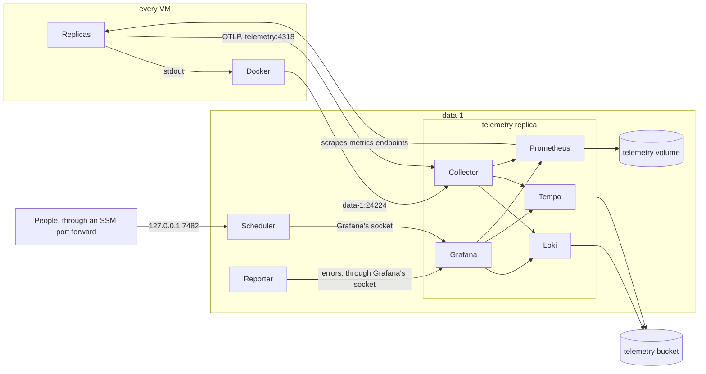

# Telemetry

An environment whose spec has `telemetry` keeps its application's logs, traces and
metrics, and lets the people who build and run it read them. ProtoStrap runs one telemetry
replica on data-1. It holds an OpenTelemetry collector that takes everything in, Loki for
logs, Tempo for traces, Prometheus for metrics, and Grafana to read them. Services need no
code for ProtoStrap: they write to stdout, and those that use OpenTelemetry find the
collector in the variables every SDK reads.

Telemetry is optional. The spec adds it with `telemetry: {}`, or with its
[settings](#settings), and an AppHost with `AddTelemetry("telemetry")`
([ProtoStrap with Aspire](protostrap-aspire.md#the-tunnel-the-gateway-and-telemetry)).
Without it, Docker sends each replica's output to CloudWatch Logs
([Without telemetry](#without-telemetry)).

| To                                                | See                                                     |
| ------------------------------------------------- | ------------------------------------------------------- |
| Know who sees what                                | [Two kinds of telemetry](#two-kinds-of-telemetry)       |
| Know what is collected                            | [What is collected](#what-is-collected)                 |
| Send logs, traces and metrics from a service      | [Sending telemetry](#sending-telemetry)                 |
| Read them                                         | [Reading telemetry](#reading-telemetry)                 |
| Hand them to an agent, such as Claude             | [For agents](#for-agents)                               |
| Set retention and size                            | [Settings](#settings)                                   |
| Know what happens when it is down                 | [When telemetry is down](#when-telemetry-is-down)       |
| Run an environment without it                     | [Without telemetry](#without-telemetry)                 |
| Move an environment that logs to CloudWatch       | [Upgrading](#upgrading)                                 |


## Two kinds of telemetry

|               | Service telemetry                                                             | Infra telemetry                                                           |
| ------------- | ----------------------------------------------------------------------------- | ------------------------------------------------------------------------- |
| **What**      | What the application emits: its replicas' output, traces and metrics, and the edge's requests | ProtoStrap's own records: the scheduler's decisions, the agents' records, and the scheduler's state |
| **Where**     | The telemetry replica on data-1: Loki and Tempo in the telemetry bucket, Prometheus on the telemetry volume | The [infra log](protostrap.md#infra-log) in the deploy bucket, and the scheduler's memory |
| **Read with** | Grafana, at `127.0.0.1:7482` on data-1                                        | The [operator UI](protostrap.md#operator-ui), at `7480` and `7481`        |
| **Who**       | Developers, Platform Admins and Org Admins                                    | Platform Admins and Org Admins                                          |

Neither flows into the other. The infra log never reaches Loki, and Grafana can't see the
scheduler. Each has its own SSM session document, so the document a person may start
decides what they see (see [Identity](identity.md#people)).


## At a glance



The telemetry replica is one container, from the `protostrap/telemetry` image of the
spec's ProtoStrap version, as the [edge](protostrap.md#edge) is. `protostrap telemetry`
writes each program's config, starts all five, and answers the agent's readiness check once
every one is ready. If one exits, the others stop and Docker restarts the container.


## What is collected

| Source                                                      | How it arrives                                                                          | Kept in    |
| ----------------------------------------------------------- | --------------------------------------------------------------------------------------- | ---------- |
| Every replica's stdout and stderr, the edge's included      | Docker's `fluentd` log driver, on the replica's VM, sends each line to the collector at data-1's fixed address, port 24224 | Loki       |
| Logs a service sends with OpenTelemetry                     | OTLP to `telemetry:4318` on the overlay                                                 | Loki       |
| Traces                                                      | OTLP                                                                                    | Tempo      |
| Metrics a service sends with OpenTelemetry                  | OTLP                                                                                    | Prometheus |
| Each component's `metrics` endpoint, and the edge's request counts | Prometheus scrapes every replica, found by name on the overlay, every 30 seconds | Prometheus |

- **Every record names its component and replica.** Stdout lines get them from the
  container's labels, and OTLP gets them from the variables ProtoStrap sets. In Loki and
  Prometheus they are `service_name` and `service_instance_id`, so one query finds a
  component's lines from both sources. A stdout line also says which stream it came from,
  as `log_iostream`: `stdout` or `stderr`.
- **Not collected:**
  - **The infra log**, which stays [apart](#two-kinds-of-telemetry).
  - **The telemetry replica's own output**, which stays on data-1 (`docker logs`), so a
    fault in the pipeline never feeds on itself. As for any replica, the agent records
    its starts, failures and restarts in the infra log.
- **`docker logs` still works** on every VM. Docker keeps the latest output of each
  replica on its VM as well as sending it.


## Sending telemetry

### Logs

Write to stdout. That's all ProtoStrap asks (see the
[application contract](protostrap.md#application-contract)).

A service that also sends its logs over OTLP, as .NET's OpenTelemetry logging does, has
each line twice: once from stdout and once from OTLP. Turn one of them off:

- **Keep OTLP and turn the console logger off,** which is usually better. OTLP records
  carry their trace's ID, so a line opens its trace. Output the program writes before its
  logging starts, and a crash's stack trace, still arrive from stderr.
- **Or keep stdout and export no logs.** Write one JSON object per line to keep fields
  apart: Loki can filter and parse them.

### Traces and metrics

With telemetry, ProtoStrap sets these variables in every replica, which OpenTelemetry's
SDKs read:

| Variable                      | Value                                                                                       |
| ----------------------------- | ------------------------------------------------------------------------------------------- |
| `OTEL_EXPORTER_OTLP_ENDPOINT` | `http://telemetry:4318`                                                                     |
| `OTEL_EXPORTER_OTLP_PROTOCOL` | `http/protobuf`                                                                             |
| `OTEL_SERVICE_NAME`           | The component's name, such as `api`                                                         |
| `OTEL_RESOURCE_ATTRIBUTES`    | `service.instance.id=<replica>,service.version=<release>,deployment.environment.name=<environment>` |

- **An SDK that reads these needs no other setting.** An SDK that picks its own protocol
  can use gRPC, on `telemetry:4317`.
- **The spec's `env` wins** for each of these variables. A component that sets one gets its
  own value instead of ProtoStrap's, and keeps ProtoStrap's for the others. The endpoint and
  the protocol go together, though: setting either drops both of ProtoStrap's, since one is
  no use without the other. An application that runs its own collector points its services
  at it this way. That collector then exports to `http://telemetry:4318`, OTLP over HTTP.
- **ProtoStrap's own replicas,** the edge and telemetry, get none of these variables.
- **A metrics endpoint needs nothing more.** A component with `metrics` is scraped as it is
  for scaling: every replica, every 30 seconds. Metrics sent over OTLP and scraped metrics
  land in the same Prometheus.
- **Label metrics by route, never by user, ID or raw path.** Prometheus keeps every
  distinct set of labels as a series in memory, so a label with unbounded values exhausts
  it.

### From browsers

The collector takes nothing from the internet: it is on the overlay only. To collect
telemetry from browsers, run a collector of the application's own as a service with a
route, and have it export to `http://telemetry:4318`.


## Reading telemetry

Grafana runs in the telemetry replica, and listens only on a Unix socket on data-1. The
scheduler serves it on data-1's loopback, at `127.0.0.1:7482`, and people reach it through
an SSM port forward, as they reach the operator UI:

```bash
scripts/telemetry.sh
```

Then open `http://localhost:7482`.

- **Who:** the `protostrap-telemetry` session document forwards port 7482 and nothing else.
  Developers, Platform Admins and Org Admins may start it in every deployed environment
  that has telemetry, such as prod, with their sign-in ([People](identity.md#people)). It
  doesn't let Developers start the operator UI's documents. Locally, Developers read their
  services' telemetry in Aspire's dashboard ([Local development](#local-development)).
- **It has no sign-in of its own.** Everyone who reaches it has the same role, Editor, since
  Grafana lets no Viewer explore. They can explore, query and build dashboards, but can't
  change a data source or add a user. Grafana's own database is in the container, not on the
  volume, so anything someone saves lasts until the replica restarts. Its data sources come
  from the image, so they are always as they were.
- **The data sources are linked.** A log line with a trace ID opens the trace in Tempo, and
  a span opens its component's logs around that time.
- **Nothing loads from elsewhere.** Grafana's update checks, news feed, avatars and plugin
  catalog are off.
- **It refuses a request that isn't for `localhost`, `127.0.0.1` or `[::1]`**, as the
  operator UI does, so a page elsewhere can't read it through a person's forward.

### Queries to start with

| To see                       | Data source | Query                                                       |
| ---------------------------- | ----------- | ----------------------------------------------------------- |
| A component's errors         | Loki        | `{service_name="api"} \|~ "(?i)error\|exception\|fatal"`    |
| One replica's output         | Loki        | `{service_instance_id="api-k3f9"}`                          |
| Slow requests                | Tempo       | `{ resource.service.name = "api" && duration > 500ms }`     |
| Requests per second, by service | Prometheus | `sum by (envoy_cluster_name) (rate(envoy_cluster_upstream_rq_total[5m]))` |

### For agents

An agent on a person's machine, such as Claude Code, queries through the same forward.
Grafana's API passes each data source's own API through:

```bash
curl -s http://localhost:7482/protostrap/help
```

`/protostrap/help` describes these calls in markdown, for an agent to read before it
queries, as the operator UI's `/api/help` does. For example, a component's errors in the
last hour:

```bash
curl -sG http://localhost:7482/api/datasources/proxy/uid/loki/loki/api/v1/query_range \
  --data-urlencode 'query={service_name="api"} |~ "(?i)error|exception"' \
  --data-urlencode since=1h --data-urlencode limit=200
```


## Settings

The spec's `telemetry` section runs the replica, and sets its size and how long it keeps
things. `telemetry: {}` runs it with the defaults below:

```yaml
telemetry:
  request: { cpu: 500m, memory: 1536Mi }
  volume: 20Gi
  retention: { logs: 30d, traces: 30d, metrics: 15d }
```

An AppHost sets the same with `AddTelemetry("telemetry")` and its `WithRequest(cpu,
memory)`, `WithVolume("20Gi")` and `WithRetention(logs:, traces:, metrics:)`, which write
only what they set.

| Field               | Default        | Meaning                                                                                  |
| ------------------- | -------------- | ---------------------------------------------------------------------------------------- |
| `request`           | 500m, 1536Mi   | What the replica reserves on data-1. Its memory is a hard limit, as for any replica      |
| `volume`            | 20Gi           | Its EBS volume: Prometheus's metrics, and Loki's and Tempo's write-ahead logs and caches |
| `retention.logs`    | 30d            | How long Loki keeps a log line                                                           |
| `retention.traces`  | 30d            | How long Tempo keeps a trace                                                             |
| `retention.metrics` | 15d            | How long Prometheus keeps a sample                                                       |

- **It runs on data-1,** and `protostrap check` makes sure it fits there beside the
  stateful components pinned to data-1, after the data pool's reserve.
- **Its programs split its memory:** Loki, Tempo and Prometheus a quarter each, and the
  collector and Grafana the rest. Each gets a soft limit at its share. The collector
  refuses data while it is over its own limit, so a burst slows intake, and the SDKs and
  Docker retry, instead of the replica running out of memory.
- **Retention is whole days, from 1d.** The telemetry bucket also expires every object
  seven days after the longer of `logs` and `traces`, in case Loki or Tempo misses one.
- **A change replaces the replica.** The old one stops before the new one starts, since only
  one can own the volume, so nothing is taken in for about a minute.
- **It runs only when the spec has it.** Leaving the section out turns it off
  ([Without telemetry](#without-telemetry)). A `telemetry:` with nothing after it, which
  YAML reads as nothing, is a mistake: `protostrap check` says to write `telemetry: {}`, or
  to leave it out.

### Where it keeps things

- **Loki and Tempo** write to the telemetry bucket, `protostrap-<account>-<region>-telemetry`,
  with the telemetry role, which may use only that bucket.
- **Prometheus** writes to the telemetry volume, `/data/telemetry` on data-1. It is an EBS
  volume like a stateful component's, and it is snapshotted daily with them. Losing it loses
  the metrics' history, and nothing else.
- **Cost:** S3 storage and requests, and the volume. CloudWatch Logs would charge for every
  GB taken in, and CloudWatch Metrics for every series.


## When telemetry is down

- **Services carry on.** Nothing waits for telemetry.
- **Stdout:** while the collector is unreachable, Docker holds up to 10,000 lines per
  replica and sends them when it's back, then drops lines past that. `docker logs` on the VM
  still has them.
- **OTLP:** SDKs retry for a short while, then drop what they couldn't send.
- **Grafana** can't be opened, and the reporter's report says it couldn't read the
  components' errors.
- **The agent** reports the replica like any other. Docker restarts it if it crashes, and if
  a new one fails or isn't ready within 5 minutes, the release rolls back.


## Without telemetry

A spec without `telemetry` runs none of it: no telemetry replica on data-1, no telemetry
volume, no `protostrap-telemetry` session document, and no port 24224 between VMs.

- **Replicas' output goes to CloudWatch Logs.** Docker's `awslogs` driver sends each
  replica's stdout and stderr, the edge's included, to its component's log group,
  `/protostrap/<app>/<component>`, which Terraform makes for every component, in a stream
  named after the replica. It never blocks the replica: Docker holds up to 4 MB while
  CloudWatch can't be reached, then drops lines. The groups keep them for
  `log_retention_days`.
- **Replicas get no `OTEL_` variables,** so an SDK that reads them sends nothing, unless the
  spec's `env` points it at a collector of the application's own.
- **Nothing keeps metrics or traces.** Agents still scrape each `metrics` endpoint for
  `metric` signals and limits, as they do with telemetry.
- **There is no Grafana** to open, and no `scripts/telemetry.sh` session.
- **The daily report** reads each component's errors from its log group, with a CloudWatch
  Logs Insights query, instead of from Loki.
- **Removing it** stops the telemetry replica and replaces every replica, the edge's
  included, as a release does, so each sends its output to its log group. Terraform
  deletes the volume, and with it the metrics' history. The telemetry bucket, role and
  repository stay, as a retired component's do, and the bucket's lifecycle rule expires the
  logs and traces in it.
- **Adding it back** replaces every replica again, so each sends its output to the collector
  and gets the `OTEL_` variables. The log groups keep what they have until it expires.
- **Cost:** CloudWatch Logs charges for every GB taken in, and for what it stores.


## Security

- **Those who write can't read.** The collector's receivers, and the readiness check, are
  the only ports on the overlay. Loki, Tempo and Prometheus listen on the replica's
  loopback, and Grafana only on its socket. A container can send telemetry, under any name,
  but can read none.
- **Port 24224 on data-1's address** admits only VMs, through the `node` security group.
  Containers can't reach it, since [their firewall](network.md#containers-and-their-vm)
  keeps them off every VM's address.
- **The socket** is in `/run/protostrap/telemetry` on data-1, which only root can open. The
  scheduler serves it on loopback alone, for the forward.
- **Anyone who can open Grafana can read every service's logs** in that environment.
  Logs hold no secret: the application contract says no value is ever in a log.


## Local development

Under `aspire run`, Aspire's dashboard plays this part, whether or not the AppHost adds
telemetry: `AddTelemetry` runs only in an account. Aspire sets the same `OTEL_` variables,
pointing at its own collector, so a service sends the same telemetry locally as in an
environment, and nothing in the spec changes. The dashboard keeps everything in memory, for
one run.


## Upgrading

Before telemetry, each replica's output went to CloudWatch Logs, through Docker's `awslogs`
driver, to a log group per component.

1. **Add `telemetry` to the spec, and make room on data-1.** `protostrap check` fails until
   the telemetry replica fits beside the stateful components there.
2. **Apply the platform.** It creates the telemetry bucket, volume and role, opens port
   24224 between VMs, and adds the `protostrap-telemetry` session document.
3. **Apply the people root,** so each group may start the new document.
4. **Release.** The scheduler starts the telemetry replica, and agents start every new
   replica with the `fluentd` driver and the `OTEL_` variables. Replicas already running
   keep CloudWatch until they are replaced, by their next release or a scale change: the
   upgrade restarts none of them.
5. **The log groups stay** for those replicas, and for a release of an earlier ProtoStrap
   that a rollback brings back. They cost only what they store, and expire it after
   `log_retention_days`.
