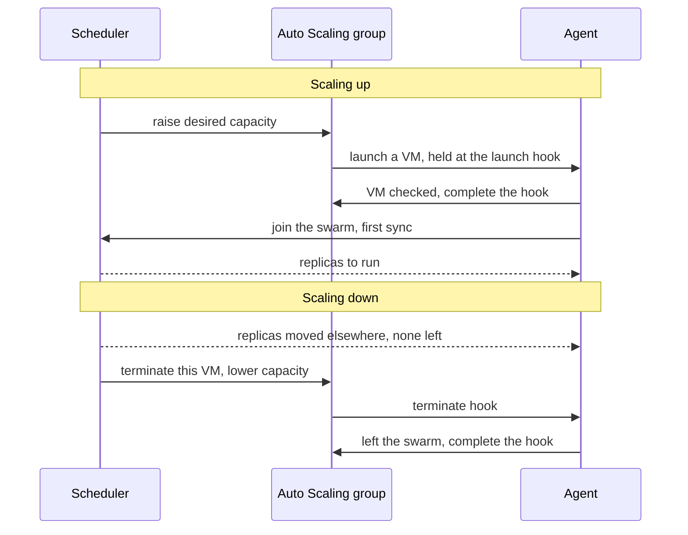

# VMs on AWS

ProtoStrap runs on four types of VM, each in its own pool. This page explains what each
type is for, how it runs on AWS, and how the scheduler grows and shrinks the pools through
Auto Scaling groups (ASGs). What runs on each type is in the README's
[VMs](../README.md#vms), the scheduler and the agent in
[How ProtoStrap is built](protostrap.md), and the network and roles in
[Network](network.md) and [Identity](identity.md). The infrastructure code and the agent
hold the exact settings.

Three rules hold throughout:

- **ProtoStrap decides, AWS carries out.** Only the scheduler changes how many VMs a pool
  has. ASGs launch VMs and replace failed ones, but have no scaling policies of their own.
- **AWS never picks which VM to remove.** Every pool VM is protected from scale-in. The
  scheduler drains the VM it chose, then terminates it.
- **No VM waits for the scheduler to launch or leave.** Each VM finishes its own launch and
  its own drain, so the platform can come back from nothing (see
  [Starting from nothing](#starting-from-nothing)).

## VM types

|                 | Ingress                        | General                                 | Compute                                          | Data                                      |
| --------------- | ------------------------------ | --------------------------------------- | ------------------------------------------------ | ----------------------------------------- |
| Runs            | The edge, and NAT for its zone | Services, and workers when jobs are few | Workers                                          | PostgreSQL, Redis, the scheduler          |
| On AWS          | An ASG of one per zone         | An ASG per zone                         | A Spot ASG per zone, with an On-Demand fallback  | One EC2 instance                          |
| VM count        | One per zone                   | Set by the scheduler, at least one      | Set by the scheduler, from zero                  | Fixed                                     |
| A failed VM     | Replaced by its ASG            | Replaced by its ASG                     | Replaced by its ASG                              | Restarted on new hardware by EC2          |
| State on the VM | None                           | None                                    | None                                             | On EBS volumes that outlive it            |

Every VM boots from the same image, Amazon Linux with the SSM Agent, and learns its pool
when it launches. Its user data installs Docker, the ECR credential helper and the
ProtoStrap agent, whose binary the infra workflow put in the deploy bucket before the apply
that made the VM, so every VM boots with its agent. Pool VMs boot the latest Amazon Linux
each time one launches, and data VMs keep theirs until they are replaced (see
[New images](#new-images)).

Every instance type is Graviton (arm64), which costs less than x86 for the same shape, and
every image is built for arm64. Any Graviton type will do, from the burstable t4g up, so a
small application starts small and moves to bigger types as it grows:

- **Burstable t4g** types are the cheapest. AWS runs them unlimited by default, so CPU above
  their baseline is billed rather than throttled. ProtoStrap counts all their vCPUs, so a
  pool that stays busy costs more on t4g than on c7g or m7g of the same size.
- **Graviton3 and later**, such as c7g, m7g, r7g and the 8g families, encrypt traffic
  between VMs in hardware. t4g and Graviton2 types, such as m6g, don't (see
  [Encryption](network.md#encryption)).

Only ingress VMs have public addresses. Every other VM sits in a private subnet and goes
out through its zone's ingress VM (see [Network](network.md)).

### Ingress

The ingress VM is its zone's way in and way out. It runs only the edge, cloudflared and
Envoy, when the spec has a gateway, and forwards the other VMs' outbound traffic (see
[NAT on the ingress VM](network.md#nat-on-the-ingress-vm)).

- **An ASG of one,** so AWS replaces it when it fails. The scheduler doesn't size this pool:
  if the edge outgrows its VM, the spec moves the pool to a bigger type.
- **The zone's address belongs to the zone, not the VM.** At boot, a new ingress VM takes
  over the zone's Elastic IP and the private subnets' route out, so nothing else changes
  when it is replaced.
- **A failed ingress VM** stops its zone's requests and outbound traffic until the
  replacement takes over, a couple of minutes.
- **A planned replacement,** for a new image, starts beside the old VM. Its edge joins the
  tunnel first, so requests never pause, and outbound traffic pauses only while the route
  moves.

### General

General VMs run the services, and workers while job volume is low.

- **On-Demand,** in one ASG per zone.
- **One shape per pool,** such as 4 vCPU and 16 GiB. The ASG can launch several
  general-purpose types of that shape, so it has more capacity to draw on. Sizing assumes
  the shape, and placement uses each VM's real capacity, which its agent reports.
- **Room to spare.** General keeps a spare VM and runs below full, so a new replica usually
  starts at once instead of waiting minutes for a VM to boot.
- **Bigger VMs later.** If services need bigger VMs, the pool gets a second shape with its
  own ASGs.

### Compute

Compute VMs run workers, which drain the job queue.

- **Spot first.** Compute runs on Spot, across many instance types: each type is a separate
  pool of Spot capacity, so the more types, the less often Spot runs out. A second ASG, on
  On-Demand, stays empty unless Spot has no capacity (see
  [When a launch fails](#when-a-launch-fails)).
- **Can sit at zero.** Compute keeps no spare VM. Workers start in general's spare room, and
  compute grows only when they no longer fit there.
- **Runs fuller than general,** since the queue absorbs a short wait.
- **Workers must be safe to run twice.** Spot can take a VM at two minutes' notice (see
  [Spot interruptions](#spot-interruptions)), and an interrupted job runs again from the
  start.

### Data

The data VM, `data-1`, is a plain EC2 instance that the infrastructure code creates. The
scheduler never launches or removes it. It runs PostgreSQL and Redis and, because it is the
one VM that is never removed, the swarm manager, the scheduler, the reporter and, if the
spec has it, [telemetry](telemetry.md).

- **A fixed private address.** Every VM joins the swarm and reaches the scheduler there, so
  it must never change. Services don't use it: they find PostgreSQL and Redis by name on the
  overlay.
- **State on EBS, never on the VM.** PostgreSQL, Redis and the swarm each keep their state
  on their own EBS volume, which outlives the instance and is snapshotted daily. Its
  instance type has no instance store, which would lose data on any stop, and supports
  EC2's automatic recovery.

#### Sharing the VM

PostgreSQL and Redis compete for one VM's CPU, memory and disk, so each gets a fixed share:

- **Memory:** each has its own limit, and each is tuned to its share, not the VM's total.
- **CPU:** each gets cores of its own, so a heavy query can't stall Redis's single thread.
- **Disk:** each has its own volume and throughput, and is sized, snapshotted and moved on
  its own.

These shares are their requests in the spec, so the sizing check shows when they no longer
fit. The telemetry replica, if the spec has one, shares the VM too, with its own memory
limit and volume, but no cores of its own. The cost of one VM is that one failure takes
them all down, along with the swarm manager and the scheduler.

#### Recovery

- **The hardware fails:** EC2's automatic recovery restarts the same instance on new
  hardware, with the same address and volumes. Docker restarts PostgreSQL and Redis, and
  the agent and the scheduler adopt them.
- **The OS hangs:** an alarm on the instance status check reboots it.
- **AWS schedules maintenance, or an outage leaves the VM impaired:** AWS Health events
  alert an operator, who stops and starts the VM to move it to new hardware.
- **The instance is lost:** an operator launches a new one with the same address, attaches
  the old volumes or restores them from snapshots, and restarts the swarm from its volume.
  The other VMs reconnect to the same address, and the scheduler picks up from its state in
  S3. If the whole zone is gone, the new VM restores from snapshots in another zone, with a
  new address, and every VM joins a new swarm, which restarts the whole application.

New images and resizes wait for a maintenance window, since restarting the VM takes
PostgreSQL and Redis offline. A new Docker version reaches the data VM before the pools, so
the swarm manager is never older than the VMs that join it.

#### Backups

Snapshots are crash-consistent and up to a day old. On top of them, the agent runs each
stateful component's `backup` command daily and streams the output to the backups bucket:

- **PostgreSQL** gets a full logical dump, which also restores into a newer version or into
  RDS. Restoring to any point in time needs continuous WAL archiving in the PostgreSQL
  image, or a move to RDS.
- **Redis** gets a dump. That is enough while Redis holds only data that can be rebuilt;
  anything else is a reason to move it to ElastiCache.

#### Moving PostgreSQL and Redis

When they outgrow one VM, the first choice is the README's
[Path to managed services](../README.md#path-to-managed-services). To keep both self-hosted
for longer, one of them moves to a second data VM, `data-2`, set up like data-1 but without
the swarm manager, the scheduler or the reporter. In a maintenance window, the component's
VM changes in the spec, the scheduler stops it, its volume moves to data-2, and the
scheduler starts it there. Services still find it by name.

Once both have moved to managed services, any other data VM goes, and data-1 stays on as the
`control` VM, resized to a small type, running only the swarm manager, the scheduler, the
reporter and, if the spec has it, telemetry. It keeps its address and its swarm volume, so nothing else notices. A general VM
would be a poor home for the manager: its ASG would replace a failed one with a new VM, and
the swarm's state would go with the old one.

## Scaling with Auto Scaling groups

The scheduler sizes general and compute every cycle, from the CPU and memory their replicas
request and the replicas waiting for room (see the README's
[Scaling VMs](../README.md#scaling-vms)). It acts on AWS in only two ways: it raises an ASG's
desired capacity to add VMs, and it terminates the VM it chose to remove. The ASG does the
rest. It launches VMs, holds each one at a launch hook and a terminate hook while the
agent readies or drains it, and replaces VMs that fail.

The scheduler reads no AWS events. It reads each ASG every cycle, and each VM's agent tells
it within seconds when AWS is about to terminate the VM.

### Scaling up

1. **The scheduler sets a target.** Each pool gets whichever is larger: the VMs sizing
   wants, or the VMs it would take to place every pending replica, within the pool's
   minimum and maximum. VMs still booting count with all their room, so one pending replica
   doesn't ask for a new VM every cycle.
2. **It raises the ASG's desired capacity** to the target. It never lowers it this way.
3. **The ASG launches a VM** and holds it at the launch hook.
4. **The agent checks the VM** and completes the hook itself. If a check fails, or the agent
   hangs, the ASG discards the VM and launches another.
5. **The agent joins the swarm and syncs.** On the first sync the scheduler counts the VM
   as ready, and its next cycle places replicas there.

The launch hook waits for nothing but the VM itself. If it waited for the scheduler, then
after an outage every new VM would time out while data-1 was down, and the ASG would keep
replacing them.

### When a launch fails

A launch fails when AWS has no capacity for any of the ASG's types in the zone, or the
account has reached an instance limit. The ASG keeps retrying. Once launches have gone
unfilled for about 10 minutes, the scheduler cancels them, by setting the ASG's desired
capacity back to the VMs it has, and:

- **Compute** grows its On-Demand ASG instead, and tries Spot again later. While both have
  VMs, On-Demand VMs are removed first.
- **General** has no fallback. Its replicas stay pending, and the scheduler tries again a
  few minutes later.

### Scaling down

Removing VMs follows sizing only, and slowly. Once sizing has wanted fewer VMs for about 10
minutes, and the replicas on the emptiest VM fit on the others, the scheduler removes that
VM, one at a time:

1. **Cordon.** Placement stops using the VM.
2. **Move its replicas off.** Each new replica starts elsewhere before the old one stops
   (see the README's [Removing replicas](../README.md#removing-replicas)).
3. **Terminate.** The scheduler terminates the VM through its ASG and lowers the desired
   capacity in the same step, so the ASG doesn't replace it.
4. **Leave.** At the terminate hook, the agent finds nothing left to stop, leaves the swarm
   and completes the hook. The scheduler then removes its node from the swarm.

Apart from cancelling launches, the scheduler never just lowers desired capacity: that
would let the ASG choose which VM to remove.

### When AWS removes a VM

The ASG also terminates VMs on its own: when one fails its health check, when Spot reclaims
it, or when someone terminates it by hand. Each goes through the same terminate hook, so it
is drained the same way, under a deadline:

1. **The agent sees the termination coming** and reports it on its next sync.
2. **The scheduler moves the VM's replicas,** starting each new one elsewhere before the old
   one stops.
3. **The agent stops whatever is left** once most of the deadline has passed, then leaves
   the swarm and completes the hook.

If the scheduler is down, the agent stops everything itself, and the replicas come back
elsewhere once the scheduler returns. If the agent is dead, the hook times out and the VM
goes anyway. On compute, the deadline stretches while jobs are still running, up to the
longest stop time of the VM's workers.

### Spot interruptions

Spot gives two minutes' warning, and no hook can extend it. The agent stops the VM's
workers on a deadline inside the warning: each stops taking jobs, finishes what it can, and
hands the rest straight back to the queue. The scheduler places replacement workers, and
the ASG launches a replacement VM.

Often the warning never comes. With Capacity Rebalancing, the ASG replaces a Spot VM as
soon as EC2 says it is at risk, and removes it through the terminate hook, with time for a
normal drain.

### Health

The ASG replaces a VM that stops or fails EC2's status checks, and systemd restarts an agent
that crashes. The scheduler covers what neither can see, a VM whose agent has gone silent:

- **After 30 seconds,** its replicas no longer count, and the scheduler places replacements
  elsewhere.
- **After 10 minutes,** the scheduler marks the VM unhealthy, and the ASG replaces it through
  the terminate hook.
- **Never many at once.** At most one VM per pool every 10 minutes, and none when more than
  half a pool went silent together: that points at the scheduler's side, which new VMs
  wouldn't fix.

A silent data VM is only reported, never replaced.

### New images

The scheduler rolls out new images itself, rather than through an ASG instance refresh, so
every VM leaves through the same drain as when scaling down, and nothing else changes the
ASGs' capacity.

1. **The infrastructure code** adds a launch template version with the new image and points
   the ASGs at it. New VMs use it from then on.
2. **The scheduler replaces each older VM,** oldest first, one at a time per ASG: it adds a
   VM, waits for it to be ready, then removes the old one as in
   [Scaling down](#scaling-down). Each ASG's maximum is one above the pool's, so this works
   even when the pool is full.
3. **A bad image stops the roll.** If a new VM isn't ready within 10 minutes, the old VMs
   keep running. Pointing the ASGs back at the previous version rolls the VMs back the same
   way.

Compute can roll several VMs at a time, and ingress VMs roll one zone at a time (see
[Ingress](#ingress)). The data VM takes a new image in a maintenance window (see
[Recovery](#recovery)).

## Starting from nothing

After an outage, or on a new deployment, the platform comes up in this order with no one
stepping in:

1. **The ingress VM starts,** or its ASG replaces it, and takes over its zone. Until then
   the other VMs can reach only S3.
2. **data-1 starts,** or EC2 recovers it. It mounts its volumes as its volume list in S3
   says, so it needn't wait for step 1. The swarm comes back from its volume, and the
   scheduler reads its state from S3.
3. **PostgreSQL and Redis start.**
4. **Pool VMs come back.** Those that survived rejoin the swarm, and the ASGs replace the
   rest. New VMs finish launching without the scheduler, and join the swarm once it
   answers.
5. **The scheduler places replicas:** the edge first, then services, then workers. Until it
   has a few minutes of signals, each component runs at no fewer than its last desired
   count, so services don't restart at their minimum into a wave of retries.

## Multiple zones

When the platform spreads across availability zones (step 3 of the README's
[Path to managed services](../README.md#path-to-managed-services)):

- **Each zone gets its own ingress VM,** so a zone's VMs never depend on another zone to get
  out.
- **Each pool gets its own ASGs in each zone.** The scheduler chooses which zone grows, so
  placement can spread each service across zones, and it sizes each zone on its own. One
  ASG across zones would let AWS choose the zone, and rebalance zones by terminating VMs.
- **The data VM stays in its zone** until PostgreSQL and Redis move to managed services.

## Failure modes

| Event                       | What happens                                                                                                          |
| --------------------------- | --------------------------------------------------------------------------------------------------------------------- |
| A general VM fails          | Its replicas are placed elsewhere within about 30 seconds, and the ASG replaces the VM.                               |
| A compute VM fails          | The same. Its jobs return to the queue when their visibility timeout ends.                                           |
| Spot reclaims a compute VM  | Workers hand back their jobs within the warning, and the ASG launches a replacement.                                 |
| Spot has no capacity        | After about 10 minutes, compute grows its On-Demand ASG instead.                                                     |
| General has no capacity     | Replicas stay pending, the spare VM absorbs what it can, and the scheduler keeps retrying.                           |
| An agent hangs              | systemd restarts it. If it stays silent for 10 minutes, the ASG replaces its VM.                                     |
| The scheduler stops         | systemd restarts it. Until then nothing scales or is placed, and everything else keeps running.                      |
| An ingress VM fails         | Its zone's requests and outbound traffic stop until the ASG replaces it, a couple of minutes. With one zone, the application is offline. |
| The data VM goes down       | The application is down. Running replicas keep running, but nothing scales or moves until EC2 recovers the VM.        |
| A zone or region goes down  | Everything is down. Once AWS recovers, the platform comes back as in [Starting from nothing](#starting-from-nothing). |
| A new image is bad          | New VMs never become ready, so the roll stops with the old VMs running.                                               |
